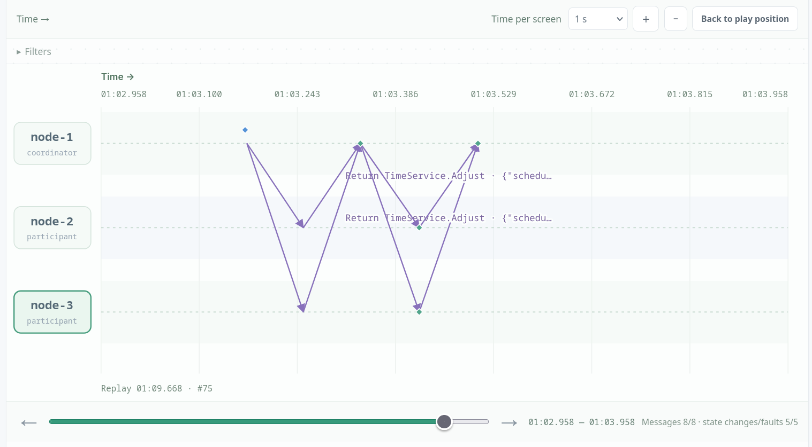
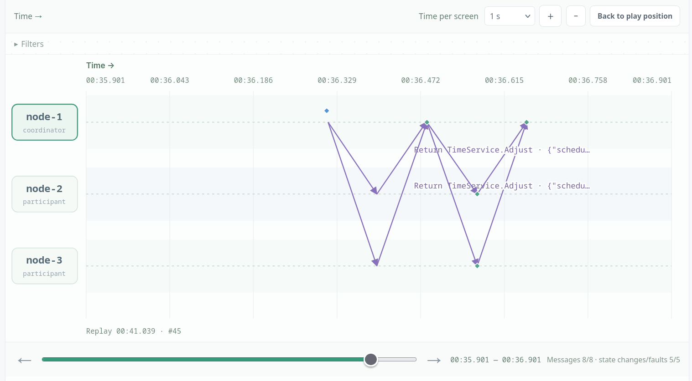

# Berkeley Clock Synchronization

## Scenario A: convergence

With the three clocks initially offset by 0, 750, and 1500 ms and zero drift, we ran one Sync on node-1. The coordinator computed a group mean of about 750 ms and scheduled corrections of roughly +733 ms, +0.35 ms, and −750 ms. Immediately after the round the corrections were still pending; a later read showed all three nodes at approximately 750 ms with pendingMS=0. This confirms that Berkeley converges to the average of the participating clocks, not to real time.

*Scenario A: the coordinator polls the group and sends `TimeService.Adjust` calls to nodes 1–3, visible as the request/return pairs in the space-time diagram.*

Initially:
node1: {"timeMS":1793014376659.0457,"hostOffsetMS":0.045654296875,"driftPPM":0,"pendingMS":0}
node2:
{"timeMS":1793014377408.0657,"hostOffsetMS":750.065673828125,"driftPPM":0,"pendingMS":0}
node3:
{"timeMS":1793014378161.0532,"hostOffsetMS":1500.05322265625,"driftPPM":0,"pendingMS":0}

After running sync on node 1:
node1:
{"timeMS":1793014471776.6123,"hostOffsetMS":17.6123046875,"driftPPM":0,"pendingMS":732.8520899239584}

node2:
{"timeMS":1793014472423.2632,"hostOffsetMS":750.26318359375,"driftPPM":0,"pendingMS":0.3508372583333712}

node3:
{"timeMS":1793014473173.123,"hostOffsetMS":1500.123046875,"driftPPM":0,"pendingMS":-750.3444698822916}

After running application.read:
node1:
{"timeMS":1793015093258.315,"hostOffsetMS":749.31494140625,"driftPPM":0,"pendingMS":0}
node2:
{"timeMS":1793015049411.0955,"hostOffsetMS":750.095458984375,"driftPPM":0,"pendingMS":0}
node3:
{"timeMS":1793015059547.1812,"hostOffsetMS":750.18115234375,"driftPPM":0,"pendingMS":0}

## Scenario B: outlier exclusion

We then set node-3 to 10000 ms and ran Sync again. Its offset was more than the 2000 ms threshold from the median (750 ms), so it was excluded from the mean; the mean of the remaining clocks was about 375 ms. The coordinator scheduled roughly +358 ms, −375 ms, and −9624 ms, and after read all three nodes had settled to about 375 ms. The outlier lost its vote in the average but still received the correction, so one bad clock did not drag the group toward 3583 ms.

*Scenario B: after node-3 is moved to +10000 ms, the coordinator still sends `TimeService.Adjust` to all three nodes, including the outlier that was excluded from the mean.*

initially:
node1: {"timeMS":1793014376659.0457,"hostOffsetMS":0.045654296875,"driftPPM":0,"pendingMS":0}
node2:
{"timeMS":1793014377408.0657,"hostOffsetMS":750.065673828125,"driftPPM":0,"pendingMS":0}
node3:
{"timeMS":1793014378161.0532,"hostOffsetMS":1500.05322265625,"driftPPM":0,"pendingMS":0}

then, after setting node3 to 10000 and running sync:
node1:
{"timeMS":1793015221889.563,"hostOffsetMS":16.56298828125,"driftPPM":0,"pendingMS":357.7802150125}

node2:
{"timeMS":1793015222538.1323,"hostOffsetMS":750.13232421875,"driftPPM":0,"pendingMS":-374.9109324125}
node3:
{"timeMS":1793015231787.8088,"hostOffsetMS":9999.808837890625,"driftPPM":0,"pendingMS":-9624.27097009375}

after running application.read:
node1:
{"timeMS":1793015355495.9573,"hostOffsetMS":374.957275390625,"driftPPM":0,"pendingMS":0}

node2:
{"timeMS":1793015359747.7346,"hostOffsetMS":374.734619140625,"driftPPM":0,"pendingMS":0}

node3:
{"timeMS":1793015363202.801,"hostOffsetMS":375.801025390625,"driftPPM":0,"pendingMS":0}

## Scenario C: jump vs. slew

We reset the clocks to 0/750/1500 ms and ran Sync in slew mode. The group mean was about 749.5 ms, and the corrections (+749.5/+0.1/−749.7 ms) were applied gradually: at 3s node-1 was at 325.7 ms and node-3 at 1184.0 ms, and at 10s all clocks had settled at about 750 ms with slewMsLeft=0. In jump mode the same mean and deltas were applied instantly, so node-3 jumped from 1500 to 750 ms in one step and slewMsLeft was immediately 0. The final state is identical, but the jump moves time backward and violates monotonicity, while slewing keeps the clock strictly increasing. Results can be seen in json files.

## Scenario D: network partition (partial round)

We blocked both directions between node-1 and node-3 and ran `Sync` on node-1. The `Poll` to node-3 timed out after 3 s, so the round used only node-1 and node-2: offsets 0 and about +749 ms relative to the coordinator, giving a mean of about +374 ms. Node-1 and node-2 were slewed toward about +375 ms, while node-3 stayed at about +1500 ms; `Sync` returned `1 of 3 adjustments were not confirmed` and the round ended in `partial_failure`.

After healing the link and running `Sync` again, all three clocks were sampled (offsets 0, about +2, and about +1127 ms relative to the coordinator). The coordinator scheduled +376, +374, and −751 ms; after the slews, all host offsets converged to about +750 ms. This shows that a partition produces a partial round: the reachable nodes are corrected using the clocks that answered, the isolated node is skipped, and convergence resumes when the link returns. See [the JSON export](berkeley_networkfault.json).

## Design variant: fixed coordinator

Berkeley synchronization here has a fixed coordinator: only node-1 can run Sync. After we crashed node-1, attempts to run Sync from another node were rejected because that node is not the coordinator, and no election or failover exists. The remaining nodes cannot compute a new round, so recovery requires starting a fresh experiment. This shows that the protocol depends on an active, agreed-upon coordinator and deliberately does not solve coordinator failure. See Json file for results.

## Discussion questions

### 1. Why converge to the group average instead of real time?

The coordinator is an ordinary participant with no external time source. It measures offsets relative to its own clock, filters outliers, and computes a common target from the surviving offsets. Every node applies `mean - itsOffset`, so all clocks move to that group mean, which may differ from UTC or the host clock; scenario A converges near +750 ms, not zero.

### 2. Why exclude an outlier but still correct it?

An outlier's offset would pull the mean far away from the healthy cluster: with 0/750/10000 ms the raw average would be about 3583 ms. The median-distance filter removes its vote, so the mean is computed only from clocks near the median (about 375 ms here). The outlier still receives `delta = mean - itsOffset`, so it is pulled back toward the group rather than left wrong.

### 3. Why is a clock jump unsafe?

A negative step can make a later clock reading smaller than an earlier one, so time is no longer monotonic. Log ordering, cache expiry, and timeout calculations can then see events out of order or negative durations. Slewing changes the clock rate (at most 10% here) and keeps time strictly increasing, which is why it is the default; the jump mode is only for comparison.

### 4. What happens when the fixed coordinator crashes?

`Sync` is accepted only on `node-1`; after it crashes, the other nodes reject the call and no new round is computed, so their clocks drift apart again. A failover would need agreement on a new coordinator, transfer of the round/generation state, and rejection of stale adjustments from the old coordinator. This implementation deliberately has none of those, so recovery requires a fresh experiment.
