# Bully Election

## Scenario A: five-node election

We started a five-node run and held an election. Node-5 became coordinator because it has the highest ID, and nodes 1–4 became followers after receiving its Coordinator announcement. No lower node won, because every higher live node answered OK and took over. So, the highest live node leads.

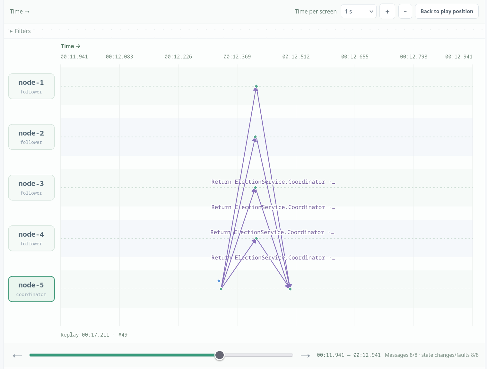

*Scenario A: after the five-node election, node-5 is coordinator and the other nodes are followers; node-5's `Coordinator` announcements are visible.*

## Scenario B: coordinator crash

Node-5 was coordinator, and we then crashed it. We triggered a new election from node-1, which sent election to nodes 2–5. Node-5 was dead, nodes 2–4 answered OK, and node-4, the highest live node, waited for node-5 to time out and then declared itself coordinator. All live nodes switched to node-4, while node-5 remained offline.

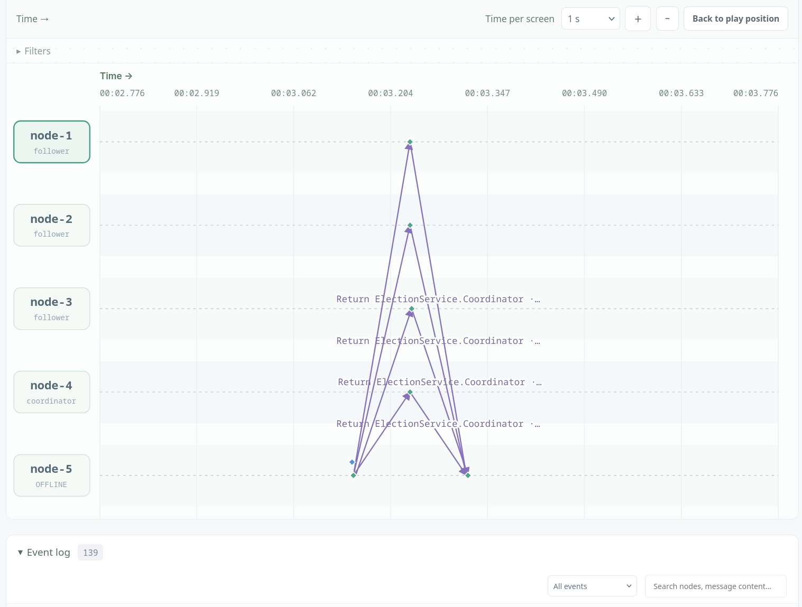

*Scenario B: node-5 is offline and node-4 has become coordinator; `Coordinator` messages announce the new leader to the remaining nodes.*

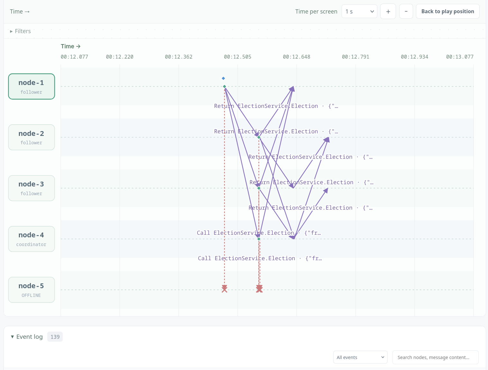

*Scenario B: node-1 triggers a new election, and `Election` calls to the dead node-5 are dropped (red X) while the higher live nodes answer.*

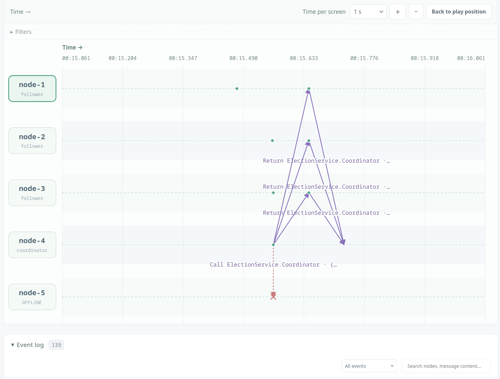

*Scenario B: the final `Coordinator` announcement from node-4 reaches the live nodes, completing the takeover.*

## Scenario C: eight-node election

Using eight-node mapping, node-8 was first made coordinator by an election started from node-4. We crashed node-8 and started another election from node-4, nodes 5–7 were still alive and node-7 was the highest live node. Node-7 won after timing out the dead node-8 and broadcast coordinator to the group. This reproduces the lecture: the initiator wakes the higher nodes, and the highest survivor becomes coordinator.

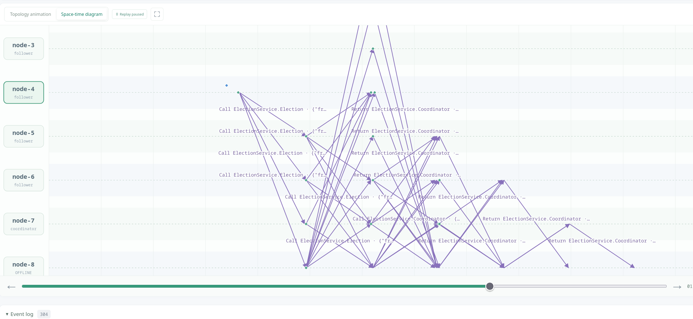

*Scenario C: in the eight-node run, node-8 is offline and node-7 becomes coordinator; the diagram shows the many `Election`/`Coordinator` exchanges.*

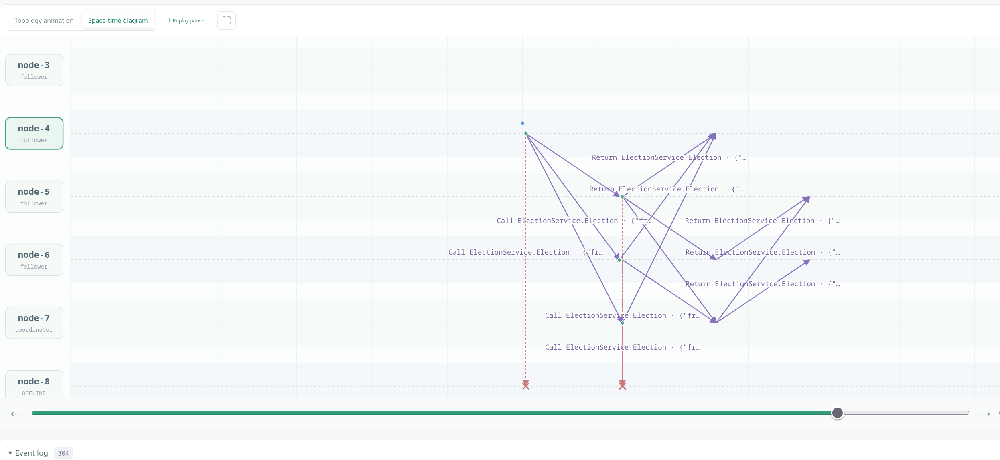

*Scenario C: the election traffic in detail, with `Election` calls to the dead node-8 dropped and the higher live nodes replying.*

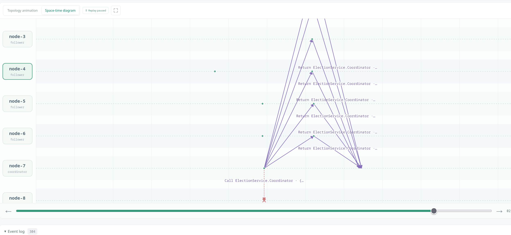

*Scenario C: node-7's `Coordinator` announcements reach the surviving nodes after the eight-node election.*

## Scenario D: two more crashes

With node-8 already down, we also crashed nodes 6 and 7. The remaining nodes were 1–5, so node-5 was now the highest live node. An election triggered from a lower node caused node-5 to campaign, time out the dead higher nodes, and win. All live nodes accepted node-5, so the two extra failures added timeout delay but still produced exactly one coordinator.

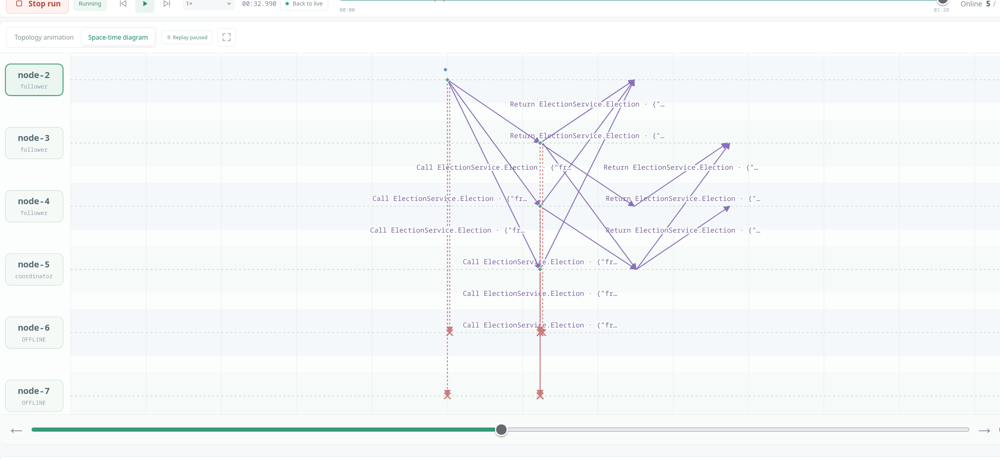

*Scenario D: with nodes 8, 7, and 6 down, node-5 campaigns; `Election` calls to the dead higher nodes are dropped and the live nodes answer.*

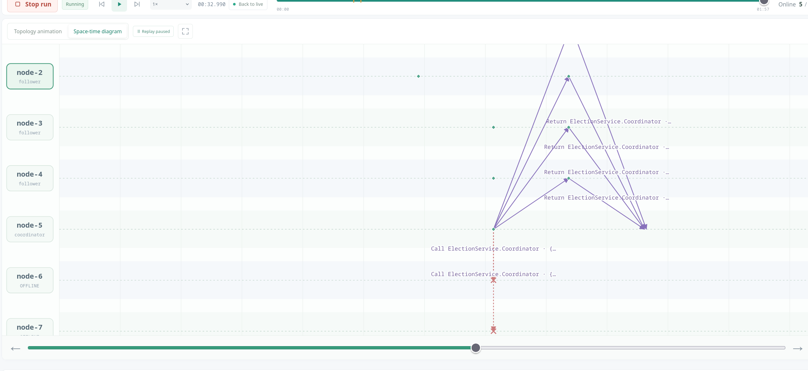

*Scenario D: node-5's `Coordinator` announcements confirm it as the highest live node.*

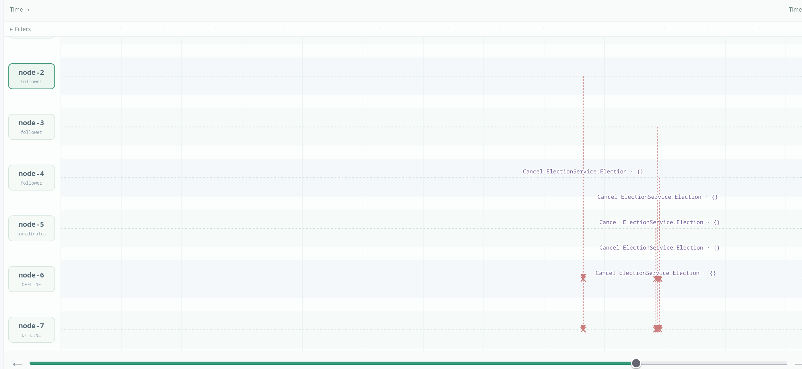

*Scenario D: obsolete `Election` calls are cancelled after the election resolves.*

## Design variant: recovered highest node

Node-7 was coordinator, then crashed; node-6 took over as the highest live node. We recovered node-7 and triggered a new election from node-4, and node-7, now the highest live node again, won. Node-6 stepped down and all live nodes switched back to node-7. This is reasonable for a preferred primary but can cause issues with frequent switching when the failure is only temporary slowdowns.

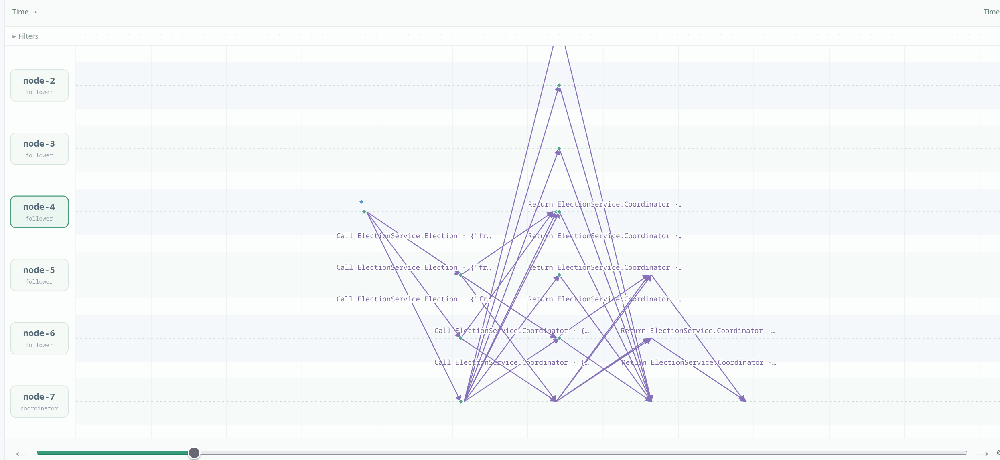

*Design variant: node-7 has recovered and is campaigning again; the `Election`/`Coordinator` traffic shows the new round.*

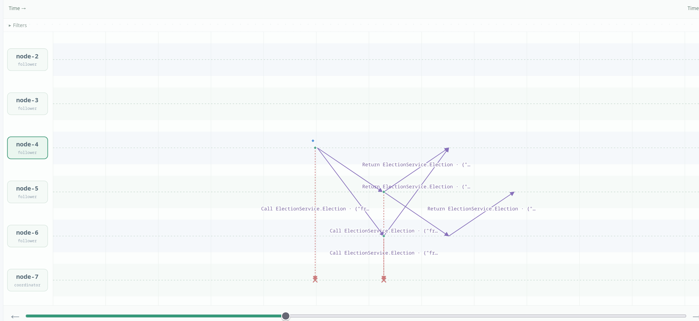

*Design variant: node-4 starts an election after node-7 recovers, and the `Election` calls reach the higher live nodes.*

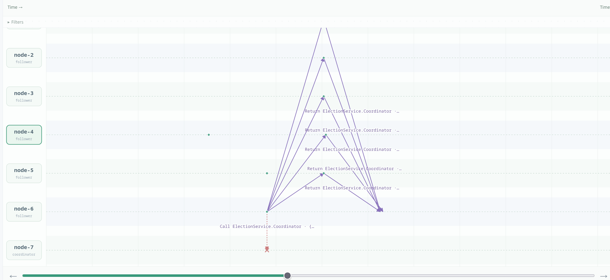

*Design variant: node-7 re-announces itself as coordinator, and node-6 steps down.*

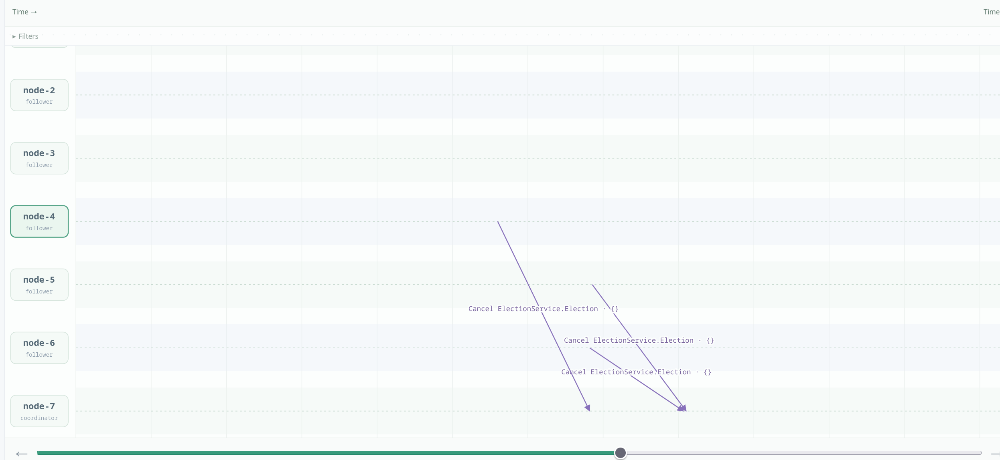

*Design variant: the remaining campaigns are cancelled as node-7 takes over again.*

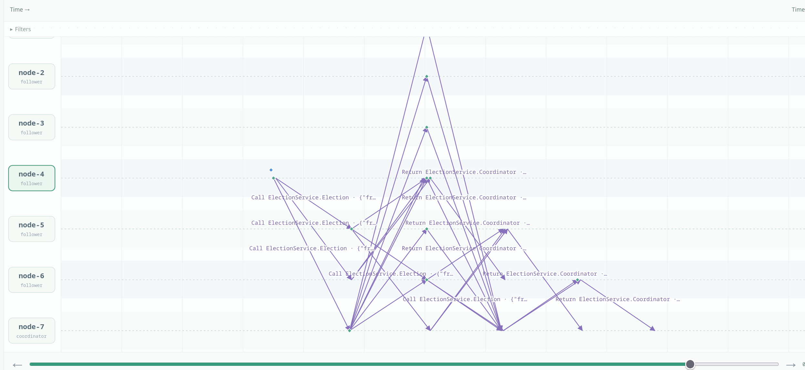

*Design variant: the final state after node-7's recovery, with node-7 as coordinator and the other nodes as followers.*

## Discussion questions

### 1. Why does the highest live node win?

Every candidate asks only higher-ID nodes and steps down if any of them answers OK. The highest live node has no higher live node to answer, so its campaign ends with no OK and it declares itself coordinator. Lower nodes either receive its Coordinator announcement or lose their own campaign, and numeric comparison (node-10 > node-2) gives every node the same priority order.

### 2. Why can an election cost quadratic messages?

If many nodes campaign at once, each sends Election to all higher nodes, and those higher nodes may start their own campaigns, producing overlapping Election/OK exchanges. Summing 1+2+...+(n-1) gives O(n^2) election messages in the worst case, plus Coordinator broadcasts. A single election started by the lowest node is cheaper, but the algorithm must remain correct when starts collide.

### 3. Can a timeout prove that a node crashed?

No. A slow process, an overloaded node, or a blocked link looks the same as a crash to a timeout, so the algorithm treats silence as suspicion rather than proof. A partition can therefore let each side elect its own coordinator, because neither side can hear the other's higher IDs. Healing alone does not reconcile them; a new election or Coordinator exchange is needed, and there is no quorum or fencing token to prevent two leaders.

### 4. Why does a recovered highest node take over?

A recovered node starts as a follower, but a new `StartElection` lets it campaign; because it has the highest ID, no higher node answers and it wins, and the current coordinator steps down when it receives the higher Coordinator announcement. This is reasonable when IDs encode preferred capacity or administrative priority. It is disruptive when the highest node is only temporarily slow or flapping, because every recovery causes another leader change.
