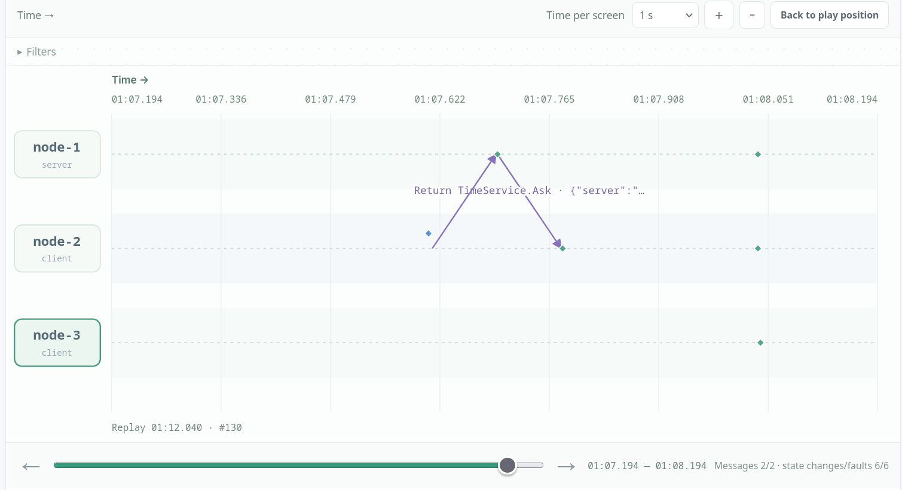
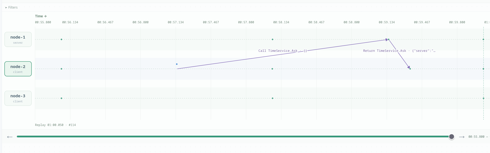
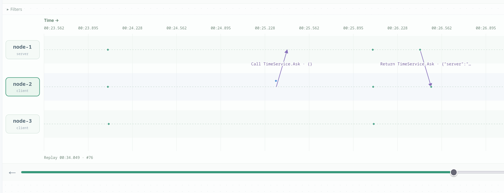

# Cristian:

## Scenario A:

I run Sync from node-2, which is running +817.7 ms ahead. The round trip takes 170.7 ms, node-2 adds half of it to the server's answer, steps its clock back 817.1 ms, and lands at errorMs = +0.6, which is essentially perfect. Left alone afterwards, the error increases with node-2's built-in drift of +1 ms/s (about +2 ms per report). So one sync fixes the clock's reading but not its speed; a real client has to sync continuously.



## Scenario B:

the request (node-2→node-1) takes 2000 ms while the reply (node-1→node-2) takes only 200 ms. The client still just measures the total, 2209.7 ms, and assumes the reply took half of it (~1105 ms) when it really took 200. The correction is therefore 900 ms too big, and node-2 ends at errorMs = +901.3, which is exactly half the difference between the two delays, (2000−200)/2. If the delays were to be swapped and the client would see an identical RTT but ends up 900 ms behind instead of ahead. So cristian can't  detect the problem, let alone fix it as it only ever sees the sum of the two one-way delays, never the split.



## Scenario C:

Instead of slowing the network, I made node-1 hold each request for 1000 ms before reading its clock (SetServerDelay(1000)). The client measures RTT = 1170.5 ms and has no way of knowing that 1000 of those milliseconds happened inside the server, not in the link. It adds RTT/2 ≈ 585 ms, overshoots, and lands at errorMs = +500.4, about half the queue delay. So a slow server and a slow network look identical to the client. That is exactly why NTP has the server remember both when it received the request and when it replied: its own processing time gets subtracted before any correction is applied.



## design variant
see experiment: Cristian design variant · +0 vs +RTT/2 vs +RTT (200 ms links)

If we use 0 instead of (T1-T0)/2, the client would sync to a clock earlier than real time by around (T1-T0)/2. If we use the entire delay, the client would sync to a clock later than real time by around the same value.

Christian design only has a very small error: 1ms.

```json
{
  "node": "node-2",
  "state": {
    "role": "client",
    "clock": "10:38:20.391",
    "clockMs": 1794307100392,
    "errorMs": -0.9375,
    "driftPPM": 1000,
    "serverDelayMs": 0,
    "served": 0,
    "syncs": 3,
    "failedSyncs": 0,
    "busy": false,
    "lastSync": {
      "server": "node-1",
      "mode": "half",
      "t0Ms": 1794307100188.9,
      "tsMs": 1794307100188.2,
      "t1Ms": 1794307100596.5,
      "rttMs": 407.6,
      "assumedOneWayMs": 203.8,
      "estimateMs": 1794307100392,
      "correctionMs": -204.5,
      "errorBoundMs": 203.8,
      "errorBeforeMs": 203.6,
      "errorAfterMs": -0.9
    },
    "lastError": ""
  },
  "seq": 44,
  "time": 2314.1018719999993,
  "timestamp": "2026-11-10T10:38:18.583Z",
  "type": "state"
}
```

While zero mode has a negative error, around the single-trip delay.

```json
{
  "node": "node-2",
  "state": {
    "role": "client",
    "clock": "10:38:18.577",
    "clockMs": 1794307098577.3,
    "errorMs": -202.97021484375,
    "driftPPM": 1000,
    "serverDelayMs": 0,
    "served": 0,
    "syncs": 1,
    "failedSyncs": 0,
    "busy": false,
    "lastSync": {
      "server": "node-1",
      "mode": "zero",
      "t0Ms": 1794307099125.4,
      "tsMs": 1794307098577.3,
      "t1Ms": 1794307099531,
      "rttMs": 405.5,
      "assumedOneWayMs": 0,
      "estimateMs": 1794307098577.3,
      "correctionMs": -953.6,
      "errorBoundMs": 405.5,
      "errorBeforeMs": 750.6,
      "errorAfterMs": -203
    },
    "lastError": ""
  },
  "seq": 21,
  "time": 701.219431000005,
  "timestamp": "2026-11-10T10:38:16.970Z",
  "type": "state"
}
```

and full mode has a postive error, around the single-trip delay.

```json
{
  "node": "node-2",
  "state": {
    "role": "client",
    "clock": "10:38:19.790",
    "clockMs": 1794307099790.7,
    "errorMs": 202.805419921875,
    "driftPPM": 1000,
    "serverDelayMs": 0,
    "served": 0,
    "syncs": 2,
    "failedSyncs": 0,
    "busy": false,
    "lastSync": {
      "server": "node-1",
      "mode": "full",
      "t0Ms": 1794307098978.7,
      "tsMs": 1794307099383.7,
      "t1Ms": 1794307099385.7,
      "rttMs": 407,
      "assumedOneWayMs": 407,
      "estimateMs": 1794307099790.7,
      "correctionMs": 405,
      "errorBoundMs": 407,
      "errorBeforeMs": -202.2,
      "errorAfterMs": 202.8
    },
    "lastError": ""
  },
  "seq": 31,
  "time": 1508.1845439999888,
  "timestamp": "2026-11-10T10:38:17.777Z",
  "type": "state"
}

```


## reflections

### Cristian's algorithm assumes the round-trip delay is symmetric; how large is the error when it is not?

Assume there's no server queueing delay, it is the difference of the two trip delays, then divided by two. Assume there's server queueing, we calculate the queueing time into the sending delay. It has a guarantee of at most RTT/2 error as long as we have an accurate server and accurate elapsed-time measurement

### Design variant discussion
Answered in the design variant section.