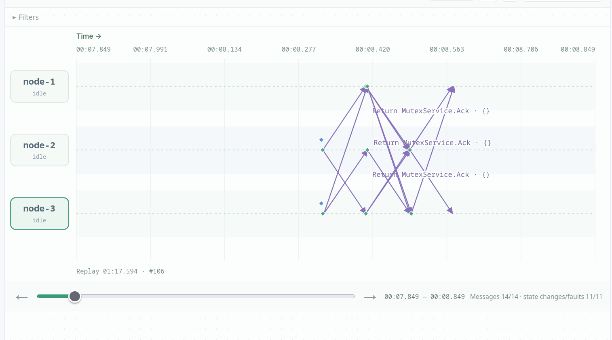
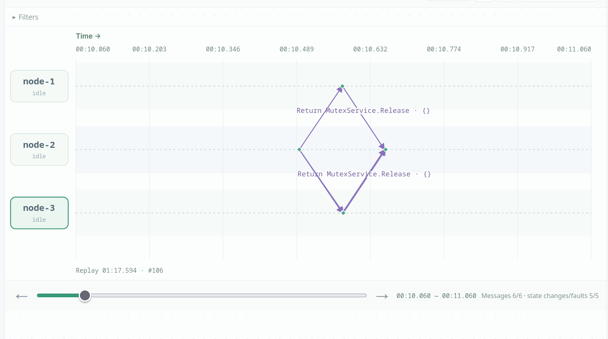
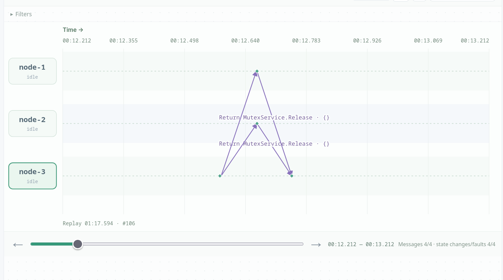
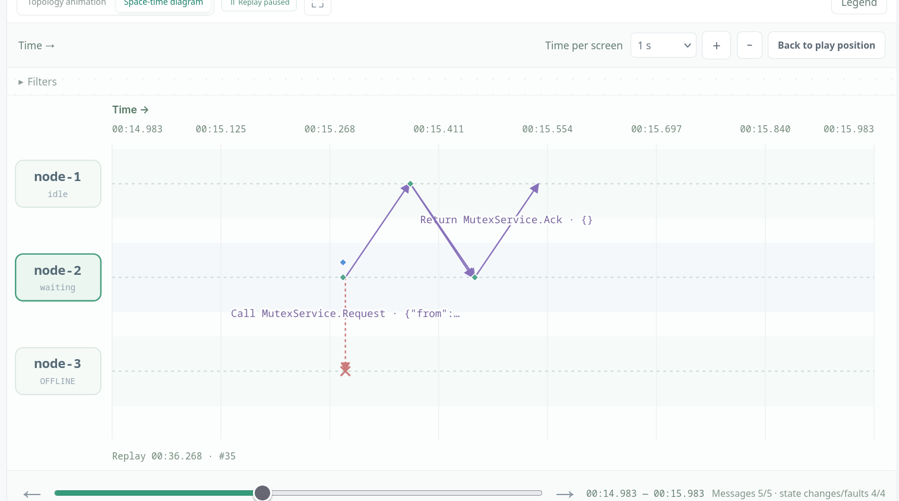
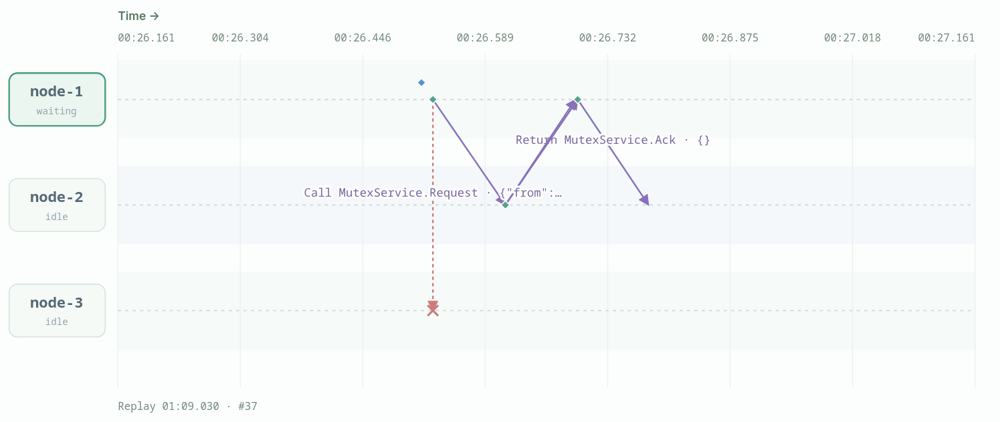
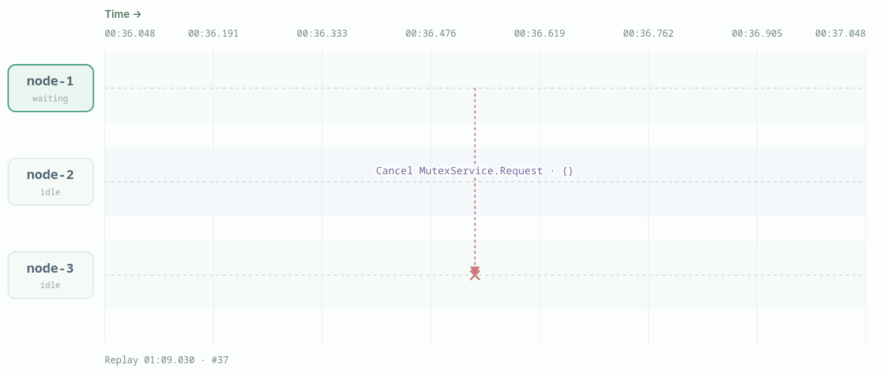

# Lamport Mutual Exclusion

## Scenario A: simultaneous requests

We triggered acquire simultaneously on node-2 and node-3 with holdMs=2000. Both requests received Lamport timestamp 1, so the tie was broken by node ID: node-2 entered first. Node-2 deferred its Ack to node-3 while it was in the critical section, so node-3 waited about 2255 ms while node-2 waited only 168 ms. The critical sections did not overlap, both nodes completed one entry, and all nodes returned to idle.

*Scenario A: node-2 and node-3 issue simultaneous Acquire requests; the diagram shows the `MutexService.Ack` replies crossing between the three nodes.*

*Scenario A: after node-2 leaves the critical section, it sends `MutexService.Release` to the other nodes, allowing the deferred requester to proceed.*

*Scenario A: a later release exchange in the same run, showing both critical sections completed and the group returning to idle.*

## Scenario B: crashed peer blocks

We crashed node-3 and then called Acquire on node-2. Node-2 sent Request to nodes 1 and 3 and received node-1's Ack, but node-3's Ack never arrived. Node-2 stayed waiting with acksHave=1 of 2 and never entered the critical section. One unrelated crash was enough to block the request; there is no failure detector or coordinator to remove the dead peer.

*Scenario B: node-3 is offline, so node-2's `MutexService.Request` to node-3 is dropped (red X); node-1's Ack arrives, but node-2 remains waiting for the missing Ack.*

## Scenario C: blocked link and no retry

We blocked both directions between `node-1` and `node-3`, then called `Acquire(holdMs=2000)` on `node-1`. `node-1` sent Request to `node-2` and `node-3`; the Request to `node-3` was dropped (red X), while `node-2` replied with an Ack. `node-1` stayed in `role=waiting` with `myTS=1`, `acksHave=1`, `acksNeed=2`, `entries=0`, and `messagesSent=2`; its queue contained only its own request. The platform call eventually returned `context deadline exceeded`, and its `Cancel MutexService.Request` to `node-3` was also dropped because the link was still blocked.

We then healed the link, but no new Request or Ack was sent. `node-1` remained waiting with one of two Acks and never entered the critical section. No retry or failure detector resends the missing message; healing the link does not replay the lost Request or Ack.

*Scenario C: after blocking node-1 ↔ node-3, node-1's Request to node-3 is dropped (red X) while node-2 returns an Ack; node-1 waits with one of two Acks.*

*Scenario C: the platform cancels the pending Request to node-3 after the Acquire call deadline; node-1 remains waiting. Healing the link does not resend the Request or Ack.*

## Design variant: message count

In a three-node run, one acquisition sends 2 Requests, 2 Acks, and 2 Releases, for 6 algorithm messages ([measured Lamport run](lamport_single_acquisition.json)). Ricart-Agrawala removes the explicit Release: deferred permissions are sent when the holder leaves, and that reply also releases the next requester, so it needs only 2 Requests + 2 Acks = 4 ([measured Ricart-Agrawala run](ricart_agrawala_single_acquisition.json)); that run records 2 Request calls and 0 Ack or Release calls. Both runs used three nodes, 80 ms latency, and a single `Acquire(holdMs=200)`. The extra Release here is the cost of keeping the explicit distributed queue and a separate release step.

## Discussion questions

### 1. Why do the queue and all Acks guarantee mutual exclusion?

All nodes order requests by the same total order `(timestamp, node ID)`, and a requester enters only when its request is at the head of its local queue and it has an Ack from every peer. If two requests compete, the one with the smaller key is ahead in every queue; the other cannot be at the head, and the earlier requester withholds its Ack while it is critical or waiting. Thus two nodes cannot both see themselves at the head and enter at the same time. The all-Acks condition ensures every node has seen the request before the requester acts on that order.

### 2. Why defer an Ack while waiting?

If a node that is waiting for an earlier request, or is already critical, replied immediately, it would grant permission to a later requester before the earlier request has finished. That could let the later requester enter while the earlier one is still waiting or holding the section, breaking mutual exclusion. Deferring the Ack keeps the later request blocked until the local critical section ends or the earlier request is released, so the total order is preserved. Ricart-Agrawala uses the same deferral, but without the explicit queue and Release.

### 3. Why does one crashed node block everyone?

Every acquisition needs an Ack from every other member, and the implementation has no failure detector, timeout-based exclusion, or retry. If one node is down or a link is blocked, its Ack never arrives, so `acksHave` stays below `n-1` and the requester waits forever. The crashed node does not need to be interested in the critical section; its absence from the reply set is enough. Healing the link does not replay the lost request or Ack, so the wait persists.

### 4. Why does Lamport need more messages than Ricart-Agrawala?

Lamport sends `n-1` Requests, `n-1` Acks, and `n-1` explicit Releases, totaling `3(n-1)`. Ricart-Agrawala folds the release into the deferred permission reply and drops the queue-head rule, so it needs only `2(n-1)`. In a three-node run this is 6 versus 4 algorithm messages; the extra round is the price of the explicit release step, not of the Lamport clock itself.
