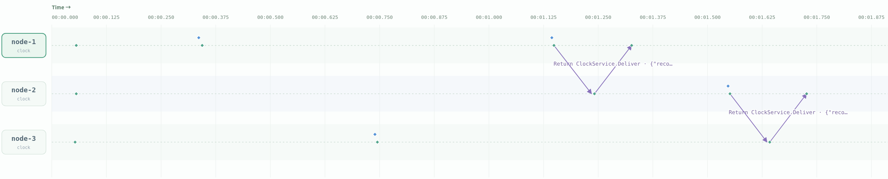
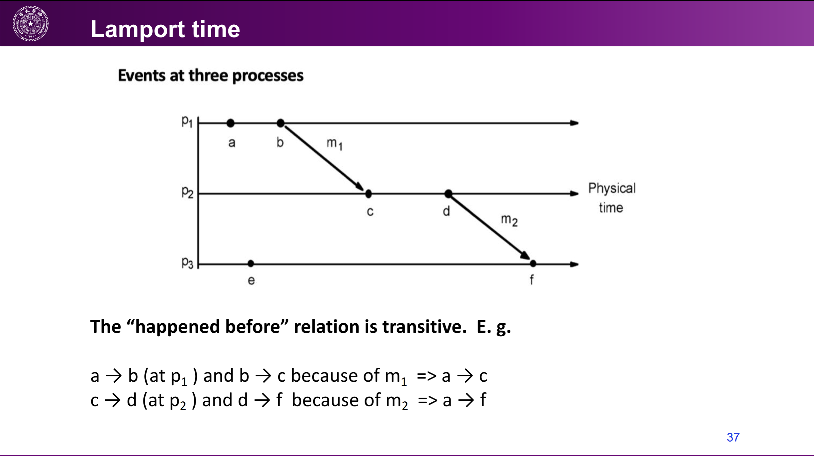

# Lamport and Vector Clocks

## normal execution: slide 37(observation scenario A)

see experiment: Clocks normal: lecture six events. [Run log](normal-six-events.json).

We created local events a and e, then sent a message from node-1 to node-2, producing b and c, and another from node-2 to node-3, producing d and f. The resulting order is a → b → c → d → f, with e → f, matching slide 37.





**The six recorded events:**

```json
[
  {"seq":14,"node":"node-1","state":{"events":[{"label":"a","timestamp":{"lamport":1,"vector":[1,0,0]}}]}},
  {"seq":17,"node":"node-3","state":{"events":[{"label":"e","timestamp":{"lamport":1,"vector":[0,0,1]}}]}},
  {"seq":20,"node":"node-1","state":{"events":[{"label":"b","timestamp":{"lamport":2,"vector":[2,0,0]}}]}},
  {"seq":24,"node":"node-2","state":{"events":[{"label":"c","timestamp":{"lamport":3,"vector":[2,1,0]}}]}},
  {"seq":31,"node":"node-2","state":{"events":[{"label":"d","timestamp":{"lamport":4,"vector":[2,2,0]}}]}},
  {"seq":35,"node":"node-3","state":{"events":[{"label":"f","timestamp":{"lamport":5,"vector":[2,2,2]}}]}}
]
```

Observe that L(b)=2 is larger than L(e)=1, but b and e are concurrent. The comparison confirms this, while b and f have both a causal order [b happens before f] and an increasing Lamport value.

**#43 compares b with e; #46 compares b with f:**

```json
[
  {"seq":43,"type":"command_result","result":{"vector":"concurrent","lamport":"a>b"}},
  {"seq":46,"type":"command_result","result":{"vector":"happens-before","lamport":"a<b","agrees":true}}
]
```

## concurrent events with equal Lamport values(observation scenario B)

see experiment: Clocks: equal Lamport concurrent events. [Run log](equal-concurrent.json).

We had each node generate one local event without sending messages. All three Lamport values are 1, but the vectors are different and every pair is concurrent. Our total-order timestamps are 3, 4, and 5, calculated as `3 * L + i`, where i is the node's position starting from zero; this order breaks ties but has no physical meaning.

**#17–#21 show the timestamps; #24, #27, and #30 compare node pairs 1/2, 1/3, and 2/3:**

```json
[
  {"seq":17,"node":"node-2","result":{"timestamp":{"lamport":1,"vector":[0,1,0],"total":4}}},
  {"seq":19,"node":"node-3","result":{"timestamp":{"lamport":1,"vector":[0,0,1],"total":5}}},
  {"seq":21,"node":"node-1","result":{"timestamp":{"lamport":1,"vector":[1,0,0],"total":3}}},
  {"seq":24,"result":{"vector":"concurrent","lamport":"equal","total":"a<b"}},
  {"seq":27,"result":{"vector":"concurrent","lamport":"equal","total":"a<b"}},
  {"seq":30,"result":{"vector":"concurrent","lamport":"equal","total":"a<b"}}
]
```

## invariant after automatic events(observation scenario C)

see experiment: Clocks: automatic random events. [Run log](auto-invariant.json).

We ran `Auto(count=6)` on all three nodes and compared three pairs after they finished. In comparison #99 the vector reports concurrent; in #102 and #105 it reports happens-before, and the Lamport order agrees. This matches the invariant: if one event happens before another, then its Lamport value is smaller.

**#97 selects one pair; #99 returns the comparison:**

```json
[
  {"seq":97,"type":"command","values":{"left":{"lamport":1,"vector":[1,0,0],"total":3},"right":{"lamport":8,"vector":[0,7,3],"total":25}}},
  {"seq":99,"type":"command_result","result":{"vector":"concurrent","lamport":"a<b","agrees":true}}
]
```

## clocks crash

see experiment: Clocks crash: durable counters. [Run log](crash-recovery.json).

We recorded an event on node-2, then crashed it; a message sent to it was dropped. After recovery, node-2 restored Lamport 1 and vector [0,1,0], and its next local event advanced them to 2 and [0,2,0] rather than starting again. A new send then succeeded, showing that saving the counters lets the node continue without reusing its old event ID.

**Before the crash, after recovery, and after a new send:**

```json
[
  {"seq":15,"node":"node-2","result":{"id":"node-2:1","label":"before","timestamp":{"lamport":1,"vector":[0,1,0]}}},
  {"seq":16,"type":"fault","fault":{"kind":"crash","node":"node-2"}},
  {"seq":21,"type":"drop","from":"node-1","to":"node-2","reason":"Destination node offline"},
  {"seq":24,"type":"fault","fault":{"kind":"recover","node":"node-2"}},
  {"seq":26,"node":"node-2","state":{"clock":{"lamport":1,"vector":[0,1,0]}}},
  {"seq":30,"node":"node-2","result":{"id":"node-2:2","label":"after","timestamp":{"lamport":2,"vector":[0,2,0]}}},
  {"seq":41,"node":"node-1","result":{"delivery":{"to":"node-2","confirmed":true}}}
]
```

## clocks partition

see experiment: Clocks partition: local events continue. [Run log](partition.json).

We blocked the connection between node-1 and node-3 in both directions. The direct message was dropped, but node-3 could still generate its own local event because this does not require communication. After restoring the link, we sent a new message, and node-3 merged its timestamp and advanced to Lamport 3 and vector [2,0,2].

**The blocked send, independent local event, and successful receive after recovery:**

```json
[
  {"seq":13,"type":"fault","fault":{"kind":"link","from":"node-1","to":"node-3","blocked":true,"bidirectional":true}},
  {"seq":17,"type":"drop","from":"node-1","to":"node-3","reason":"Link blocked"},
  {"seq":22,"node":"node-3","result":{"label":"independent","timestamp":{"lamport":1,"vector":[0,0,1]}}},
  {"seq":23,"type":"fault","fault":{"kind":"heal"}},
  {"seq":29,"node":"node-3","state":{"events":[{"kind":"receive","label":"new-receive","timestamp":{"lamport":3,"vector":[2,0,2]}}]}},
  {"seq":34,"node":"node-1","result":{"delivery":{"to":"node-3","confirmed":true}}}
]
```

## design variant: omit receive merge

see experiment: Clocks variant: omit receive merge. [Run log](variant-no-merge.json).

We enabled `omitReceiveMerge` on node-2, then created a local event on node-1 and sent a message to node-2. The send b has Lamport 2, but its receive c has Lamport 1, violating b → c ⇒ L(b) < L(c); their matching `messageID` confirms that they belong to the same message. The vectors also incorrectly say concurrent, showing that the receive must include the sender's clock before incrementing its own.

**#20 and #24 are the matching send and receive; #32 compares them:**

```json
[
  {"seq":13,"node":"node-2","values":{"omitReceiveMerge":true}},
  {"seq":20,"node":"node-1","state":{"events":[{"kind":"send","label":"b","messageID":"node-1:2","timestamp":{"lamport":2,"vector":[2,0,0]}}]}},
  {"seq":24,"node":"node-2","state":{"events":[{"kind":"receive","label":"c","messageID":"node-1:2","timestamp":{"lamport":1,"vector":[0,1,0]}}]}},
  {"seq":32,"type":"command_result","result":{"vector":"concurrent","lamport":"a>b","agrees":true}}
]
```


## Reflections

### 1. What does a successful Send mean if delivery is not confirmed?

It means the local send event was recorded, not that the other node received it. This is because we commit with commitLocked function, recording the event and updating the clock.

### 2. Does the index order in total-ordered timestamp have any meaning?

No, it is simply for resolving ties. A smaller node index does not mean that its event happened earlier in physical time or caused the other event.

## reproduction

With Docker running, start the platform with `npm start` from the repository root. In another terminal, run:

```bash
DISTVIS_RUNTIME=docker \
DISTVIS_EVIDENCE_DIR=./evidence \
  node scripts/scenarios.mjs run logical-clocks \
  normal-six-events equal-concurrent auto-invariant crash-recovery partition variant-no-merge
```


