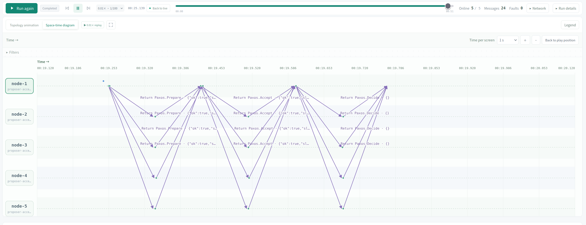
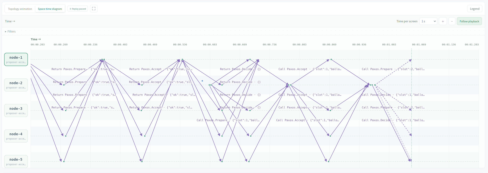
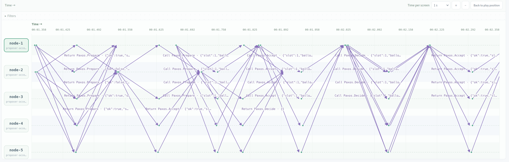
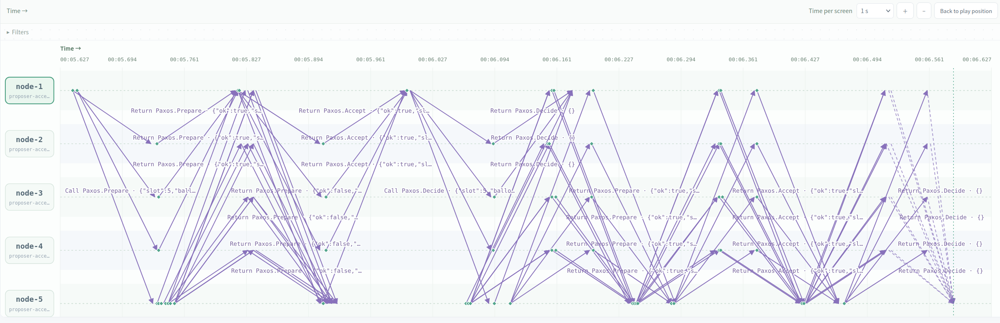
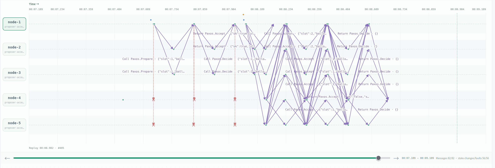
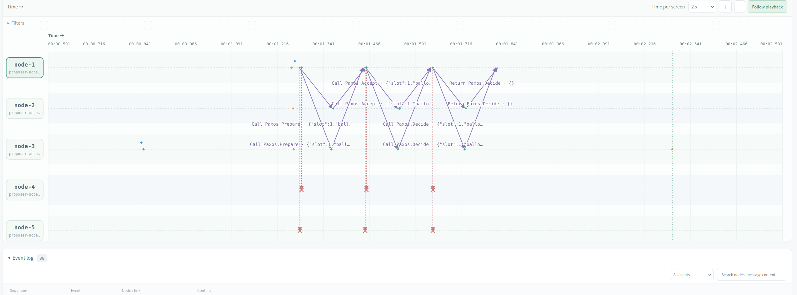
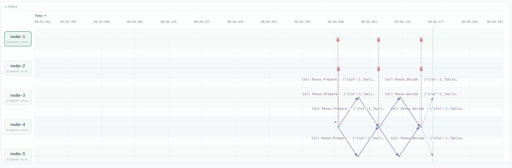

# Paxos replicated state machine KV

## normal scenario(observation scenario A)

see experiment: Paxos KV normal: reads also occupy slots.



this screenshot shows the process of one log. First we use Paxos to get a majority vote agreeing on the log, next the proposer who receives majority would take the obligation to tell everyone that this slot has been decided upon.

Only after a node receives the decision notice, does it treat the slot as decided. Before that, even if it has accepted a value, it can still send out prepare requests on that slot.

Decision has two usages:

1. to determine what slot should I propose for my next operation
2. to determine whether I should apply a operation



If a node received a preparation for an already decided slot, it shall reply as usual: It replies ack with its accepted value, and then the proposer will propagate that decided value to everyone in its accepting stage, as shown in the image above.

**#159 — node-3 replies to node-2's Accept request with the original Put value.** The slot is already marked `decided: true`.

```json
{
  "seq": 159,
  "type": "send",
  "from": "node-3",
  "to": "node-2",
  "payload": {
    "type": "RPCResponse",
    "method": "Paxos.Accept",
    "body": {
      "ok": true,
      "slot": {
        "promised": 18,
        "accepted": 18,
        "value": {
          "id": "node-1-1",
          "kind": "put",
          "key": "x",
          "value": "1"
        },
        "decided": true
      }
    }
  }
}
```

Observe that the Get is also an operation on the log.

When does the Get return? it returns right after the Get log gets decided

Every time a node receives a decision, it will execute applyLocked(), seeing if it can apply more decisions from its current point s.disk.Applied

The applying procedure is as demonstrated by the code below:

```go
if _, done := s.disk.Results[op.ID]; !done {
	result := Result{ID: op.ID, Slot: number}
	switch op.Kind {
	case "put":
		s.disk.Values[op.Key] = op.Value
		result.Value, result.Found = op.Value, true
	case "get":
		// The two-result map lookup distinguishes an absent key from
		// an existing key whose value happens to be an empty string.
		result.Value, result.Found = s.disk.Values[op.Key]
	case "noop":
		// Recovery may choose an operation that changes nothing. It
		// still occupies a slot and lets later decisions be applied.
	}
	s.disk.Results[op.ID] = result
}
```

this piece of code is executed by everybody, not only the proposer of the slot.

## two writes compete for the same slot(observation scenario B)

see experiment: Paxos KV: simultaneous slot-one proposals.



Here's what happens when two nodes(here for example node1 and node2) happen to Put at the same time.

In this case, node 1 has a smaller ballot than node 2, all the nodes will eventually listen to node2.

### node-3: processing node-2's request first

Some nodes process node-2's request first, then reject node-1's lower ballot. node-3 is an example, even though its displayed receive events show node-1's request arriving first:

| Event | What happened |
|---|---|
| **#47** | node-3 received node-1's `Prepare(slot=1, ballot=17)`. |
| **#48** | node-3 received node-2's `Prepare(slot=1, ballot=18)`. |
| **#55** | node-3 reported slot 1 with **`promised: 18`**. |
| **#56** | node-3 sent **`ok: true` to node-2**, with `promised: 18`. |
| **#57** | node-3 again reported `promised: 18`. |
| **#58** | node-3 sent **`ok: false` to node-1**, with `promised: 18`. |

Very interestingly, receiving a message first does not guarantee processing it first.

### node-5: processing node-1's request first

Other nodes process node-1's request first and return a positive reply. node-5 demonstrates this order:

| Event | What happened |
|---|---|
| **#34** | node-5 received node-1's `Prepare(slot=1, ballot=17)`. |
| **#35** | node-5 received node-2's `Prepare(slot=1, ballot=18)`. |
| **#44** | node-5 reported slot 1 with **`promised: 17`**. |
| **#45** | node-5 sent **`ok: true` to node-1**, with `promised: 17`. |
| **#51** | node-5 reported slot 1 with **`promised: 18`**. |
| **#52** | node-5 sent **`ok: true` to node-2**, with `promised: 18`. |

node-5 first promised ballot 17. It then processed ballot 18, which was higher than its current promise, so it raised the promise to 18 and replied positively to node-2 as well.

Both nodes received node-1's request before node-2's, but their handlers processed the requests in different orders. This explains why node-3 rejected node-1's Prepare while node-5 acknowledged it.

If node 1 receives enough acks it may happen to march into the acception stage, and then fail there, in our experiment however, this is not the case.

After failing, it goes through a randomized time period of waiting and then retry.

```go
// Random backoff [wait 40..199 ms before retrying] reduces the chance
// of competing proposers repeatedly interrupting each other. Retry
// starts at Prepare with a new ballot, not by resending Accept alone.
time.Sleep(time.Duration(40+rand.IntN(160)) * time.Millisecond)
```

In our example, it retries and then finds out that people have accepted slot1 to be node2's proposal, then it helps to propagate this proposal.

After that, it continues to propose its Get on slot 2 and succeeded.

## crash and catch-up(observation scenario C)

see experiment: Paxos KV crash: no-op hole recovery

We killed node-5, and then after a while recovered it. Now it has missed out lots of decisions, and it has a very small ballot relative to the others.

we see that after node 5 receives a prepare message of a slot ahead of its own latest applied slot, it then runs s.fillHole(i). That's because a slot won't be prepared until all the slots preceding have been decided, hence this very message implies that those slots has already been decided and thus worth finding out.

If we don't do this, node 5 will still be able to receive further decisions, but it will never get to apply them.

The code logic is as follows:

```go
for i := s.disk.Applied + 1; i < args.Slot; i++ {
	if !s.disk.Slots[i].Decided && !s.catching[i] {
		s.catching[i] = true
		// Start recovery separately so this Prepare can return its promise.
		// fillHole will acquire s.mu after this handler releases it.
		go s.fillHole(i)
	}
}
```

in which args.Slot is the Slot argument in the preparation message.

fillHole() is essentially executing Paxos pipeline for the missing slot.

```go
func (s *Server) fillHole(number int) {
	defer func() {
		s.mu.Lock()
		delete(s.catching, number)
		s.mu.Unlock()
	}()

	_, _ = s.choose(
		number,
		Operation{
			ID:   fmt.Sprintf("noop-%s-%d", s.id, number),
			Kind: "noop",
		},
		time.Now().Add(6*time.Second),
	)
}
```

"noop" is just treated as an ordinary operation, except that when we apply it we do nothing.



So we observe that node 5 first gets rejected because its ballot is so small, and then after rejection it updates ballot, prepares again, and gets the answers, do the propagation process to others again, so as to catch up with others.

In this example, we see that even if a node dies, paxos can continue to function, and after recover the node can easily catch up, showing the robustness of the algorithm

## a minority partition cannot commit(observation scenario D)

see experiment: Paxos KV partition: minority cannot commit

Partition happens, and then the minority partition loses availibility in CAP, meaning that it can no longer make actions to the log, while the majority may still be able to do so.



After recovery, the two nodes catch up with the same way that we've discussed on the last section.

## design variant: amnesia

see experiment: Paxos KV variant: forgetful intersection accepts conflicting slot

We turned off saving to disk by enabling amnesia for node 3.

We first created partition 123/45, and logged slot 1 in that partition.Then node 3 crashed and forgot about it, after that we partitioned the network into 12/345, in the 345 partition we decided slot 1 again.

Now we have two conflicting decisions, indicating that saving to disk for surviving crashes on all the nodes is very important.





## Reflections

### 1. Why does Get occupy a space in log?

That's because this can ensure linearizability. Because a put will succeed once our node executes it successfully, but the other nodes may have not yet. Then if we happen to call Get on such a node after success of Put, we would get stale data.

### 2. What is the main trick of Paxos?

The main trick is that, if we know a majority of nodes **accept** the same value at the same timestamp(not time), then we can mathematically prove that all accept messages in further timestamps will all have this particular value by induction:

For each timestamp larger, if it goes to accepting stage, we know in preparation stage, a majority of nodes respond, all having had the smaller timestamp, due to induction hypothesis, the one of them with the largest timestamp must have our decided value.

This still holds even if there's network partition.

### 3. What happens after Paxos?

After it executes the paxos pipeline, it returns with three possible results:

1. timeout: it failed to confirm that it reached a majority, either in prepare stage or accept stage. In this case this operation is considered to fail.Interestingly, this operation may be accepted by some nodes, and later propagated to majority. So it might eventually be decided.
2. learned some other operation, and successfully got it decided. It will move on to retry on the next slot.
3. the intended operation is decided.

```go
if chosen.ID == op.ID {
	result, applied := s.disk.Results[op.ID]
	if applied {
		// Return the saved result.
		return nil
	}
}

// Continue with the same operation in the next slot.
number++
```

We check that it is applied, and then return. This checking is somehow redundant because there's no way it's not applied in our experiments.

Also, we have a handling for redundant operations(the exact same operation with the same ID happen to be decided in multiple slots), but there's no way that would happen in our experiments.

But these kinds of handling might be useful for other implementation variants, so we kept it.

### 4. Why is prepare needed? why do we need them to promise not to accept proposals with a lower slot?

1. Prepare finds out what has been chosen.
2. Promising is needed in the proof of our **main trick**. If we have reached majority at a certain timestamp, for each timestamp larger, the preparation stage of it must happen after the acception of our decision, only in this way can we guarantee that the preparation response should take back our decision

#### What goes wrong without the promise?

Consider one slot, three acceptors A, B, C, and a majority of two:

An older proposer finishes Prepare with ballot 10 and plans to propose operation X. Its Accept messages are delayed.

A newer proposer sends Prepare with ballot 20 to B and C. Neither has accepted anything yet, so it chooses its own operation Y.

Without the promise rule, the delayed Accept(10, X) can now reach A and B, and both accept it. X is chosen.

Before the decision announcement arrives, Accept(20, Y) reaches B and C. Both accept it. Y is also chosen.

### 5. Must older Prepare requests be rejected, and must value selection use only positive replies?

If a node has promised a newer ballot, now we know it should not accept older timestamps.

In the standard implementation, we also let it refuse prepares with older timestamps, and also the proposer only implies his proposing value from positive replies.

But I think these implementation details can be changed, for example, promise for older timestamps(but remaining its own higher promise), or let the proposer imply the value to propose from both positive and negative replies.(but it must gather a majority number of positive replies though).Our proof would still hold.

### 6. why do we check in accept stage whether the slot has been decided?

Because a node might not have accepted the operation before we receive the decide message.(It only takes a majority to decide something). So an accept request after decision may still pass the ballot test, though it definitely won't change the majority decision in the end. It will be wasteful if we use the original accepting pipeline again. We just need to keep the decision.

## reproduction

Run this automated script to reproduce our experiments:

```bash
DISTVIS_RUNTIME=docker \
DISTVIS_EVIDENCE_DIR=./evidence \
  node scripts/scenarios.mjs run paxos-kv
```