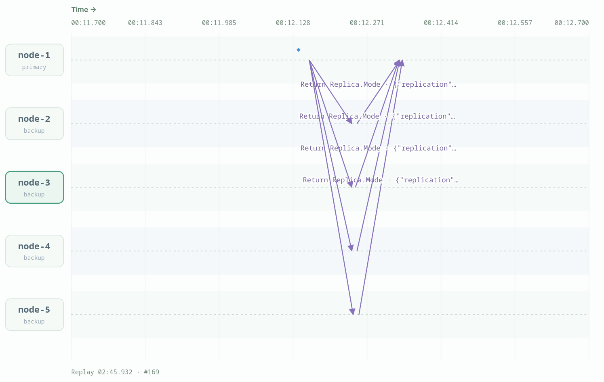
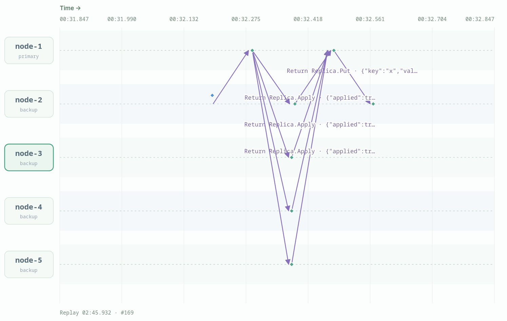
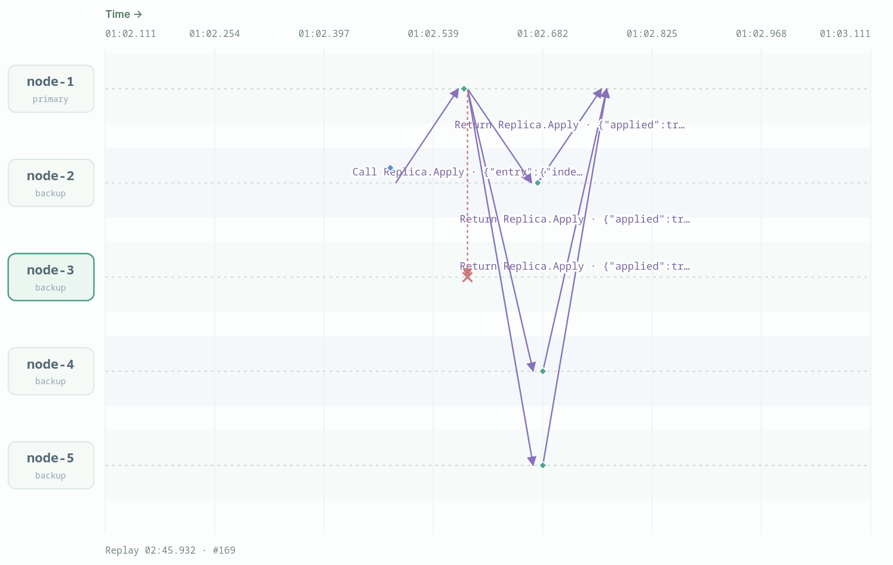
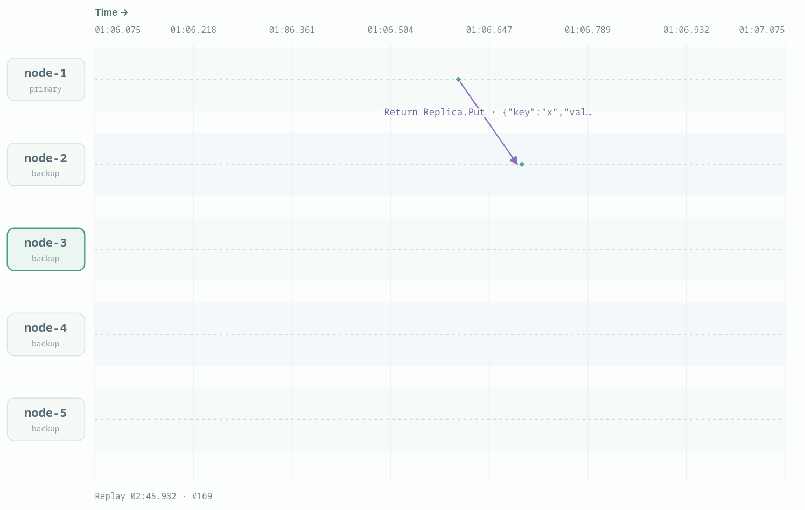
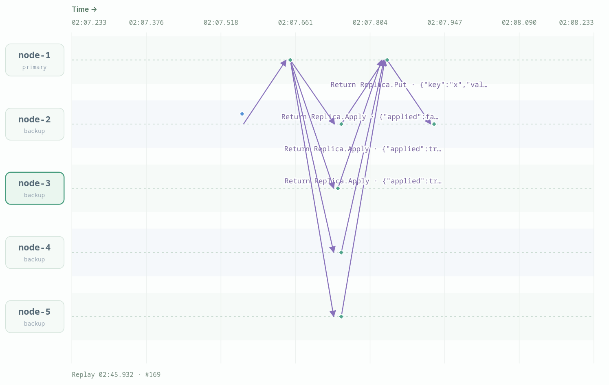

# Primary-Backup Replication

## Scenario A: async stale reads

We set Mode to async with replicationDelayMs=4000 and wrote x=1 on node-2. The write returned in about 190ms with acks:0, so the primary had applied it and answered without waiting for a backup. An immediate local read on node-2 returned found:false, stale:true, index:0. A primary read returned 1 in about 0.2 seconds. A session read with minIndex=1 waited about 3.0 seconds and then returned 1; it started about 1 second after the write, so the value arrived roughly 4 seconds after the write. The write had already succeeded while node-2 still showed the old value. That is async replication: fast writes, but reads can be out of date.

## Scenario B: sync replication and a backup crash

We set Mode to sync, so a write only replies after every backup acknowledges it. The first write went through normally: acks:4 after about 370ms, because all five nodes were up. We then crashed node-3 and wrote x=2, and the write failed after 4 seconds with missing acks from node-3. The state after the failure showed node-1, node-2, node-4 and node-5 with x=2; only the crashed node-3 still had x=1. The timeout meant the primary could not prove delivery, not that the write was rolled back.

## Scenario C: partition and no log repair

We set sync replication and wrote `x=1`; all four backups acknowledged it. We then blocked both directions between `node-1` and `node-3` and wrote `x=2` on `node-2`. The write failed after about 4 seconds with `index 2 applied on primary but sync replication timed out; missing acks from node-3: no reply`, but the primary and the reachable backups still held `x=2`; a local read on `node-3` returned `x=1` with `stale:true`.

After healing the link, we wrote `x=3`. The write returned successfully with `acks:4`, but `node-3` still had `store.x="1"`, `appliedIndex=1`, `pending=1`, and `index=3`: it had buffered index 3 because index 2 was missing, and the primary never resent index 2. A session read on `node-3` with `minIndex=3` could not satisfy its wait; it timed out after 9 s (`waitedMs=9004`) and recorded `lastGet` with mode `session`, `stale:true` and index 0. Sync replication proved receipt, not application, and the primary never repaired the missing index.

State evidence after the healed write: `node-1`, `node-2`, `node-4` and `node-5` had `index=3`, `appliedIndex=3`, and `store.x="3"`; `node-3` had `index=3`, `appliedIndex=1`, `pending=1`, and `store.x="1"`. The primary's `lastWrite` reported `acks:4`.

*Scenario C: sync replication is selected on the primary and mirrored to the backups.*

*The initial `x=1` write succeeds; all four backups return `applied:true`.*

*After blocking `node-1` ↔ `node-3`, the `Apply` for `x=2` to `node-3` is dropped (red X) while the other backups apply it, so the sync write times out.*

*The failed `x=2` `Put` response returns to `node-2`; the primary and the reachable backups already applied the value.*

*After healing, the `x=3` write is acknowledged by all backups; `node-3` returns `applied:false` because it buffered index 3 and is still waiting for the missing index 2.*

## Design variant: primary crash

We set Mode to sync, wrote x=1 to all nodes, then crashed node-1, the primary. A write sent to node-2 and a primary read on node-2 both waited for 10 seconds and failed, because there is no primary to forward to and no election to pick a new one. Only a local read worked, returning x=1 with stale:true. When node-1 recovered it came back with its state intact, but no backup had taken over. Primary-backup here depends on one agreed-upon primary, and it does not solve what happens when that primary dies.

## Discussion questions

### 1. Why can an async write be invisible to a local read?

In async mode the primary applies the write, replies to the client immediately, and only later (after `replicationDelayMs`) sends Apply to the backups. A local read on the backup before that replication arrives reads the old store and is marked `stale` because it is a backup. The write's success means the primary accepted and applied it, not that every replica has it. Scenario A trades fast writes for temporarily stale reads.

### 2. Why does a sync timeout not mean the write failed?

The primary applies and persists the write locally before it starts replication, then waits for backup acks. If a backup is down or slow, the call returns an error after the 4 s deadline, but the primary and the backups that received the entry may already have applied it. A timeout means the primary could not prove that everyone received it, not that the write was rolled back. The next read may therefore see the "failed" value, as scenario B shows for x=2.

### 3. What do local, primary, and session reads guarantee?

`local` reads only this node's store; it is fast, but a backup may be stale and is always marked `stale` here. `primary` forwards to node-1, so it sees the primary's latest applied state, but it fails if the primary is unreachable. `session` reads on a backup wait until `appliedIndex >= minIndex` (up to 9 s), so a client that passes the index of its last write gets read-your-writes; it is not a global snapshot or linearizable read across all keys. None of these modes repairs a backup that is permanently behind.

### 4. Why is a separate primary election needed?

The primary is hard-coded as `node-1`; backups only forward writes and apply entries, and there is no election, lease, or log-repair protocol. If node-1 crashes, writes and primary reads fail after the forwarding timeout, and local reads on backups may be stale. A real system needs a consensus or election layer to choose a new primary and transfer the latest log before accepting writes. Failover is out of scope here.

