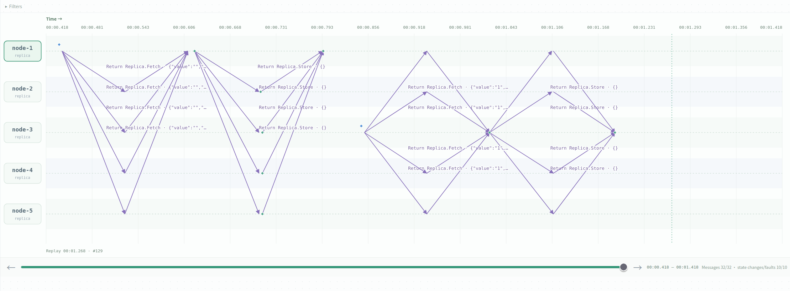
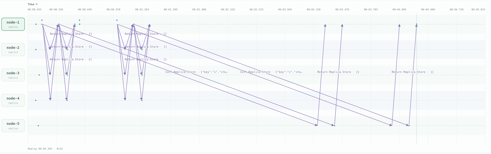
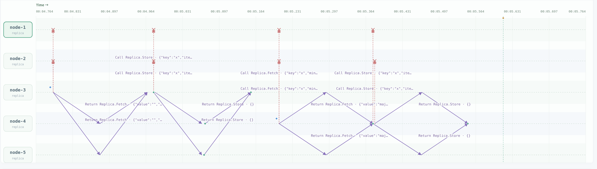
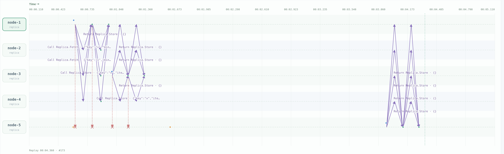
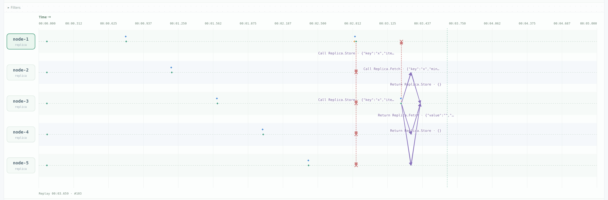

# quorum-kv

## normal scenario

see experiment: Quorum normal: sequential write and read.

In our normal scenario experiment, n is set to 5, w and r are both set to 3.

In the implementation, for each write, we first do fetch R to get the latest version number, then do store W with a newer version; for each read, we first do fetch R to read the result, then do store W to further propagate the result.



## extremely slow node
see experiment: Quorum: fastest majority versus all replicas.

We first use W and R to be both 3, and then conduct a write(including fetch+write), it finishes quickly in #62.

Then we set W to be 5, R still 3. The fetch finishes, however the write does not finish until node5 replies, in #132, which is very slow.



**#62 — W=3, R=3: succeeds in 354.615 ms without waiting for node-5.**

```json
{
  "seq": 62,
  "type": "command_result",
  "node": "node-1",
  "result": {
    "key": "x",
    "item": {"value": "1"},
    "responders": ["node-1", "node-2", "node-4"],
    "waitedMs": 354.615,
    "success": true
  }
}
```

**#132 — W=5, R=3: succeeds in 3272.792 ms after all five replicas, including node-5, acknowledge the write.**

```json
{
  "seq": 132,
  "type": "command_result",
  "node": "node-1",
  "result": {
    "key": "x",
    "item": {"value": "2"},
    "responders": ["node-1", "node-2", "node-3", "node-4", "node-5"],
    "waitedMs": 3272.792,
    "success": true
  }
}
```

## network partition
see experiment: Quorum partition: minority unavailable.

Here we use R and W both set to (n+1)/2 rounded upwards.

node1 and node2 are the minority partition, and the rest form the majority.

node1 tries to write in #23, however it only receives reply from node2 and itself. After a 4s timeout, it failed in its fetch stage, shown by #37.

implementation of our timeout:

```go
timer := time.NewTimer(4 * time.Second)
defer timer.Stop()
select {
case done := <-pending.Done:
	err = done.Error
case <-timer.C:
	answers <- answer{node: id, err: fmt.Errorf("timeout")}
	return
```

However, in the majority partition writing can still succeed.



## one node crashes
see experiment: Quorum crash: majority still available.

This is like a partition between one node and the rest of the world.

The rest of the world can still operate well, and after the crashed node recovers, a read on it will return the latest data, because it will read the newer version from the other nodes, showing the robustness of Quorum.


## design variant: too small W and R
see experiment: Quorum variant: W=R=1 stale read

Writing waits for W acks before it returns success. Here, we killed the network connections from 1, but the write still returns success due to its low requirement.

An interesting thing to node, in common cases, if the network works well, even if writing returns early, the messages besides the W ealiest ones will still be delivered after that. 

Most of the times the local copy returns the fastest, our code ensures this behaviour for experimental purpose by:

```go
invoke(s.id)
for _, id := range s.members {
	if id != s.id {
		go invoke(id)
	}
}
```

Thus when node-3 reads, it reads the stale copy from itself. The messages to other nodes are still sent, but the read operation returns before they receive replies, in #59.

`"version":{"counter":0,"writer":""}` proves that this is the stale result.



**#56 — W=R=1: node-3 requests x with minCounter=1.** 

```json
{
  "seq": 56,
  "type": "command",
  "node": "node-3",
  "values": {
    "key": "x",
    "minCounter": 1
  }
}
```

**#59 — The read succeeds in 0.058 ms using only node-3's response, but returns the initial empty value with counter 0.** Since 0 is below the requested minimum of 1, we detected the `stale` is true.

```json
{
  "seq": 59,
  "type": "command_result",
  "node": "node-3",
  "commandId": "input-56",
  "result": {
    "key": "x",
    "item": {
      "value": "",
      "version": {"counter": 0, "writer": ""}
    },
    "responders": ["node-3"],
    "waitedMs": 0.058,
    "success": true,
    "stale": true
  }
}
```


## reflections:

### Why do we need to fetch version first before we write?

Because we need that version to decide our writing version number. And the fetching needs to reach R nodes, while the later write needs to reach W nodes.

If two nodes happen to want to write to the same key at the same time, the one who writes with a later version number wins.

### Why do we write back what we read after reading?

A write may be half finished, it may still be in process or have already timed-out, there may be less than W written nodes. In that case. We read it on a node, this node then asks more than R nodes, to get the latest version. If we don't write, the next time we read we might read from another set of R nodes, and probably get the older data, violating linearizability. 

It's important to note that writing to itself will be enough for sequential consistency on a single node, but not enough for linearizability.

### What kind of consistency does quorum replication guarantee?

With a fixed, complete configuration satisfying W+R>N, durable versioned storage, and the version-query and read-writeback phases, it guanrantees per-key linearizability.


## reproduction

Run this automated script to reproduce our experiments:

```bash
DISTVIS_RUNTIME=docker \
DISTVIS_EVIDENCE_DIR=./evidence \
  node scripts/scenarios.mjs run quorum-kv \
  crash normal partition slow-replica variant-nonintersection

```