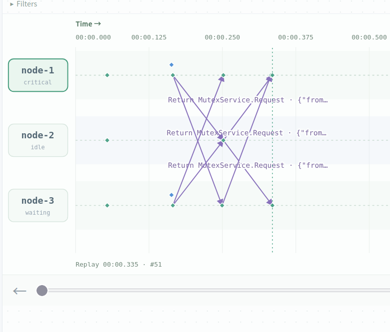
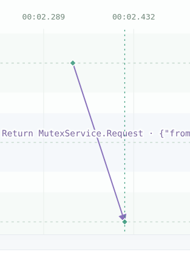
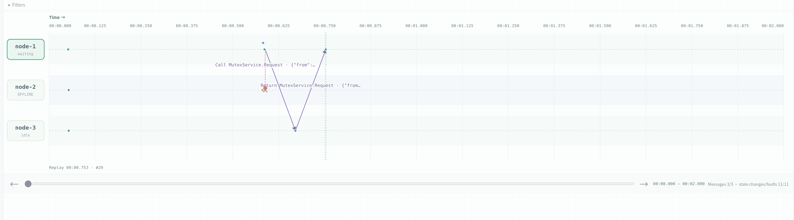
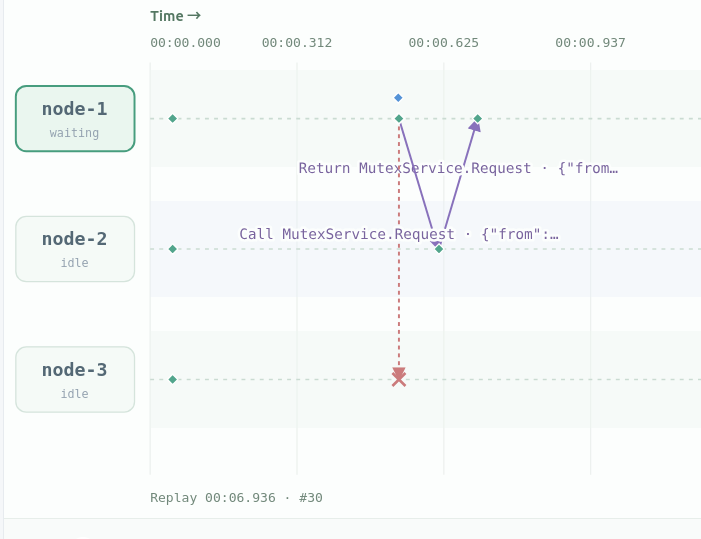

# ricart-agrawala

## normal execution (observation scenario A)

> see experiment: RA normal: simultaneous node-1 and node-3



node1 and node3 simutaneously acquire the lock, node1 wins because it has a smaller timestamp(due to its smaller index). So node2 acks both, node3 acks node1, while node1 does not ack node3 until it finishes executing its critical section.



The waiting time for node-1 and node-3 are respectively:

```json
"lastWaitMs": 168.866,
```

```json
"lastWaitMs": 2253.027,
```

## passer-by's crash (observation scenario B)

> see experiment: RA crash: uninvolved peer blocks



as log #29 shows, node-1 keeps waiting because it hasn't received node-2's ack, showing that the algorithm is vunerable to crashing node.

```json
{
  "node": "node-1",
  "state": {
    "node": "node-1",
    "algorithm": "ricart-agrawala",
    "reportSeq": 5,
    "clock": 4,
    "role": "waiting",
    "myTS": 1,
    "acksHave": 1,
    "acksNeed": 2,
    "missingAcks": [
      "node-2"
    ],
    "deferred": [],
    "entries": 0,
    "completed": 0,
    "lastWaitMs": 0,
    "messagesSent": 2,
    "sendErrors": 0,
    "lastError": "",
    "operation": "waiting",
    "operationRunning": true,
    "autoRunning": false
  },
  "seq": 29,
  "time": 753.1390480026603,
  "timestamp": "2026-11-07T13:06:51.359Z",
  "type": "state"
}
```

## random load on a jittered network (observation scenario C, though not exponential)

> see experiment: RA random load: unordered messages

We used the following network setting to conduct experiment. We make the network jitter by adding a big range of reorder amount relative to latency. We intentionally did not use exponential jitter because this is already enough.

```json
"id": "jitter-unordered",
"name": "RA random load: unordered messages",
"settings": {
  "nodeCount": 5,
  "latency": 20,
  "delayModel": "fixed",
  "jitter": 0,
  "network": {
    "ordering": "unordered",
    "reorderRate": 1,
    "reorderMin": 0,
    "reorderMax": 500
  }
},
```

We let each node acquire lock for 10 times, each holding for 1 sec then release, with a random amount of time between release and the next acquire:

```go
timer := time.NewTimer(time.Duration(100+rand.IntN(500)) * time.Millisecond)
```

We find that **message reordering does not break mutual exclusion in this run**.

### JSON evidence

**Reordering occurred:** on node-5 → node-1, message `20` was sent before `23`, but delivered after it:

```json
[
  {"seq": 71,  "type": "send",    "id": "df2fc5ab-20"},
  {"seq": 84,  "type": "send",    "id": "df2fc5ab-23"},
  {"seq": 102, "type": "deliver", "id": "df2fc5ab-23"},
  {"seq": 129, "type": "deliver", "id": "df2fc5ab-20"}
]
```

**Example of non-overlapping critical sections:** node-1 became idle before node-2 entered:

```json
[
  {"seq": 134, "node": "node-1", "state": {"role": "critical"}},
  {"seq": 173, "node": "node-1", "state": {"role": "idle"}},
  {"seq": 208, "node": "node-2", "state": {"role": "critical"}},
  {"seq": 216, "node": "node-2", "state": {"role": "idle"}}
]
```

Checking every state event found **at most one reported holder at a time**, across **50 completed acquisitions** and **18 reversed delivery pairs on the same directed link**.

For the reason, please refer to the [reflection part](#why-is-mutual-exclusion-guaranteed-for-out-of-order-messages).

## blocked link (don't even need a partition, a broken link paralyzes the algorithm)

> see experiment: RA partition: no replay after healing

We break the link between 1 and 3, and let 1 acquire the lock. After that, restore the link.

Since we didn't implement retrying in our code, node 1 thinks node 3 is knowingly keeping it waiting, while node3 haven't received anything. After that every acquire would be blocked by the waiting node-1, hence the entire algorithm is paralyzed.



## design variant: Lamport Mutual Exclusion

### Totally ordered multicast

The key design point is that when we want to deliver(execute) a message, we need to make sure that we have delivered all messages that may possibly have smaller timestamps.

We can ensure this after we have received ack of this message from everyone else, given that the connection is TCP. Because, if a message is sent after the ack to me, it will certainly have a larger timestamp.

### Lamport Mutual Exclusion

The difference is that, an acquire of node A is only delivered by node A itself(by entering the critical section). It won't need to be delivered by other nodes.

Due to this, only the sender needs acks.

After finishing the critical section a node broadcasts release. And a node will be able to enter critical section once all the acquires with previous timestamps have been released.

### comparison

- Based on totally ordered multicast, classical Lamport Mutual Exclusion replies on FIFO, which is a drawback compared to R&A algorithm.
- Also, R&A Mutual Exclusion needs `2(n-1)` messages for each request, while Lamport needs `3(n-1)`.
- But an advantage that both share is that the transfer of the lock to an already waiting node only needs 1 message delivery, which is the theoretical minimum, faster than centralized algorithms.

## reflections

### Why is mutual exclusion guaranteed for out-of-order messages?

We prove the following property: consider two critical section acquires A and B, A's TS is bigger than B's, then critical section A can only start after B ends.

That's because, by the time A's acquire message reach B's node, B has already been made(otherwise B's TS would be larger), then the node would wait until B finishes before permitting A.

The proof doesn't rely on FIFO messaging.

## reproduction

Run this automated script from the repository root to reproduce our experiments, with Docker and the platform running:

```bash
DISTVIS_RUNTIME=docker \
DISTVIS_EVIDENCE_DIR=./evidence \
  node scripts/scenarios.mjs run ricart-agrawala
```
