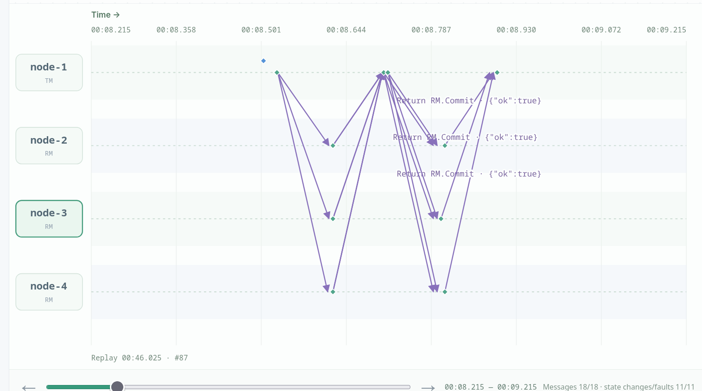
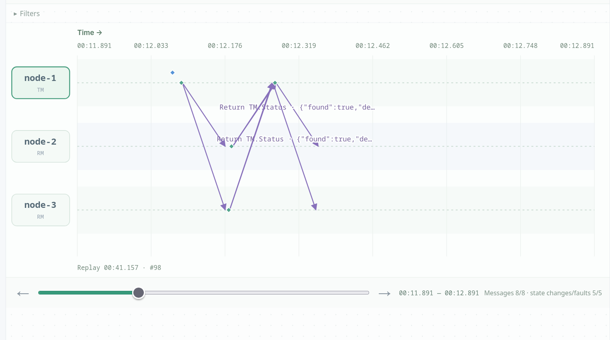
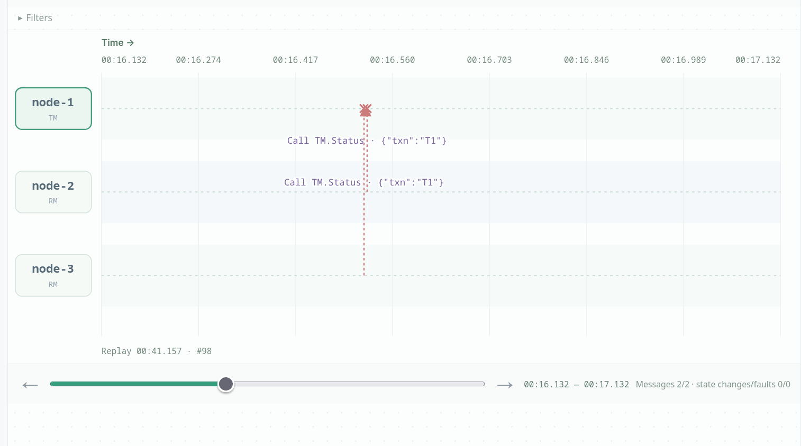
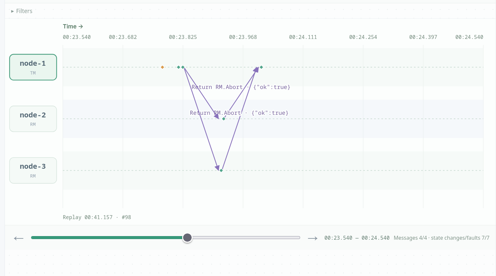
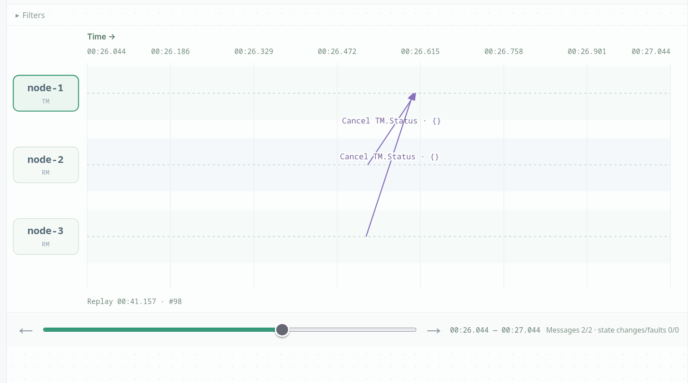
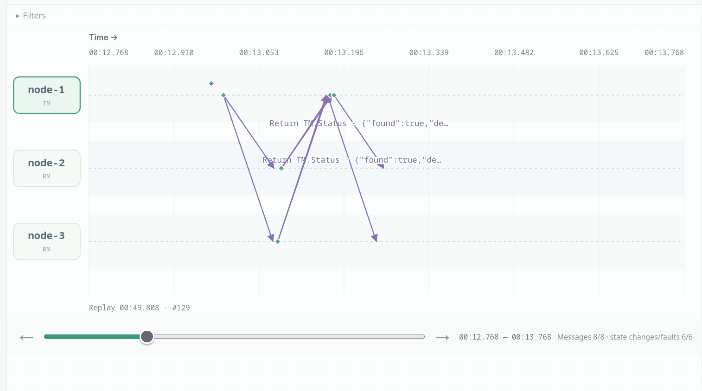
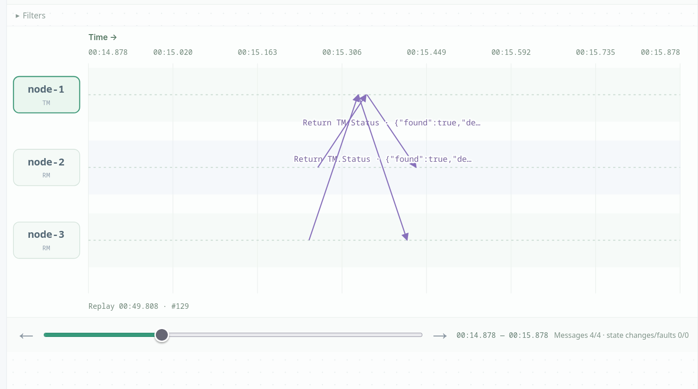
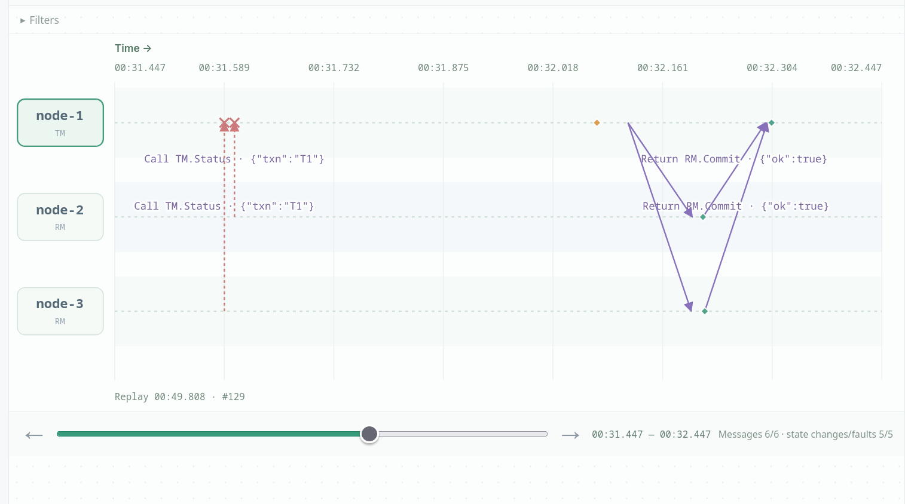
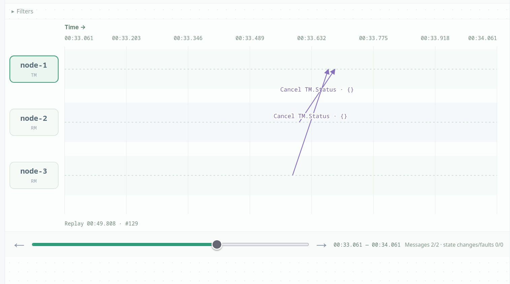

# Two-Phase Commit

## Scenario A: normal commit

We transfer 30 from node-2 to node-3. The TM sends RM.Prepare to all three RMs; node-2 (-30), node-3 (+30) and node-4 (0) all answer vote:"yes" and enter prepared, so the TM writes commit to its log and sends RM.Commit. node-2 drops to 70, node-3 rises to 130, and node-4 stays at 100, keeping the total at 300, and all four nodes record the same outcome. See [the export](2pc_scenA.json).



*Scenario A: the TM sends `RM.Commit` to all three RMs, and each returns `{"ok":true}`, completing the normal transfer.*

## Scenario B: insufficient-funds veto

We transfer 150, which exceeds node-2's balance of 100. node-2 answers vote:"no" with reason "insufficient funds", while node-3 has already answered vote:"yes" and locked a +150 delta. The TM sees the No and writes abort, then sends RM.Abort, which releases node-3's lock and leaves both balances at 100. This demonstrates that 2PC follows the all-or-nothing rule: one resource that cannot pay forces the whole transaction to fail, unlike Paxos/Raft where a majority is enough. See [the export](2pc_scenB.json).

## Scenario C: crash before decision

We start a transfer of 100 with pauseBeforeDecisionMs=30000; both RMs vote YES and lock, and the TM pauses with decision:"" after persisting the preparing record but before writing the decision. We crash node-1, and the RMs' TM.Status polls are dropped, so they enter uncertain and stay locked in a blocking state. When we recover node-1, it finds no decision in its log and so it writes abort and releases both RMs, with balances unchanged. The contrast with D shows that the logical commit instant is the log write, not the moment a participant sees Commit.



*Scenario C: while the TM is paused before writing its decision, the prepared RMs poll `TM.Status` and receive `{"found":true,...}` responses.*



*Scenario C: the TM is crashed, so the RMs' `TM.Status` calls are dropped and the participants become uncertain.*



*Scenario C: after the TM recovers and presumes abort, it sends `RM.Abort`; the RMs return `{"ok":true}` and release their locks.*



*Scenario C: the RMs cancel their `TM.Status` polling after the abort decision, leaving the balances unchanged.*

## Scenario D: crash after decision

We start a transfer of 100 with pauseAfterDecisionMs=30000. The TM writes commit to its log but crashes before notifying anyone. The RMs are prepared (locked) during the pause, and once the crash makes their TM.Status polls fail they become uncertain, with balances unchanged. On recovery the TM re-reads its log, sees commit, and resends RM.Commit until both RMs acknowledge, moving each balance exactly once. This shows that durability at the commit point is what turns a crash from an abort into a completed transfer.



*Scenario D: the prepared RMs poll `TM.Status` while the TM is paused after writing the commit decision.*



*Scenario D: the prepared RMs continue polling `TM.Status` while the TM is paused; the response shows that the transaction is found.*



*Scenario D: the TM is crashed, so the RMs' `TM.Status` calls are dropped; after recovery the TM resends `RM.Commit` and the RMs return `{"ok":true}`.*



*Scenario D: the RMs cancel their `TM.Status` polling after the commit is delivered, and each balance is updated exactly once.*

## Scenario E: network partition during commit

We started a transfer of 100 from node-2 to node-3 with `pauseBeforeDecisionMs=30000`, waited until both RMs had voted YES and were prepared, and then blocked both directions between node-1 and node-3. The TM wrote commit and node-2 applied it (balance 0), but node-3 could not be reached, so its balance stayed 100 and it reported `uncertain`; the TM remained `decided` with `acks:{node-2:true}` and kept retrying the missing Commit. The platform call itself returned `context deadline exceeded` before the 30 s pause ended; the transaction continued on the nodes.

After healing the link at about 32.8 s, the TM's retry reached node-3; node-3 committed (balance 200), the TM marked both acknowledgments and reached `finished`. Each balance changed exactly once. This shows that a network partition after the votes does not change the durable decision, but it can delay Commit and leave a prepared RM uncertain until the link returns. See [the JSON export](2pc_networkfault.json).

## Design variant: missing prepared record

We start a transfer of 100 with pauseAfterDecisionMs=30000 after removing the sdk.Save in RM.Prepare, so a vote:"yes" is never persisted: an RM that votes YES and then crashes restarts with no record. It keeps its old balance, while the TM has already collected all YES votes and commits, and the other RM applies the transfer. The result is two RMs that disagree about the transaction's outcome, a violation of 2PC's all-or-nothing guarantee. The TM remains in decided with acks:{node-3:true} and keeps resending RM.Commit to node-2, which keeps answering no prepared record for T1 and the transaction never finishes. This is the same lesson as Paxos "amnesia": a vote must be durable before it is sent, or recovery can contradict what was already decided.

For the design-variant run we removed these lines from a copy of `protocol.go`; the submitted protocol keeps them:

```go
if err := rm.persistLocked(); err != nil {
	return err
}
```

## Discussion questions

### 1. Why is a majority not enough?

A transfer touches two different accounts, and each RM owns a resource that may be unable to perform its part, for example because of insufficient funds. Committing with only a majority would let the debit and credit diverge: some RMs commit and others abort, violating all-or-nothing. Paxos chooses one value by majority; 2PC must wait for every participant's YES because every participant must be able to carry out the transaction. One NO, or a missing vote, is therefore enough to abort.

### 2. Why must a prepared RM stay locked?

After voting YES, the RM has promised to apply the transaction if the TM decides commit, but it does not know the decision yet. If it released the lock and presumed abort, the TM might already have written commit and another RM might already have applied its delta, producing inconsistency. So it keeps the prepared record and lock, polls `TM.Status`, and becomes `uncertain` until it learns the durable decision. This blocking behavior is the cost of 2PC's all-or-nothing guarantee.

### 3. Why save the prepared record before voting yes?

A YES vote is a durable promise: after a crash, the RM must still know which transaction it promised to commit and what delta to apply. If it votes YES but crashes before saving, it restarts with no record, presumes it never participated, and may keep its old balance while the TM commits and other RMs apply the transfer. The design variant demonstrates exactly this inconsistency: node-2 keeps 100 while node-3 is credited to 200, so the two accounts no longer sum to the original total, and the TM stays stuck resending Commit. Saving before replying makes recovery consistent with the vote the TM already counted.

### 4. Why is the log write the commit point?

The TM writes `commit` to stable storage before notifying any RM. If it crashes after that write, recovery reads commit and resends it until all RMs acknowledge; if it crashes before the write, recovery finds no decision and aborts. The first Commit message may be lost or delayed, so it cannot define the outcome; the durable log record is the single point after which the decision is irrevocable. This is why scenarios C and D have opposite outcomes even though both crash the TM.

### 5. Why is resending Commit safe?

`RM.Commit` is idempotent: if the RM has already committed that transaction, it returns OK without applying the delta again. The RM persists the committed state and new balance before acknowledging, so a duplicate Commit after a lost ack sees the completed outcome and only re-acknowledges. This lets the TM retry after a crash without double-crediting or double-debiting. It does not make an arbitrary repeated client `Transfer` idempotent, because each transfer gets a new transaction ID.
